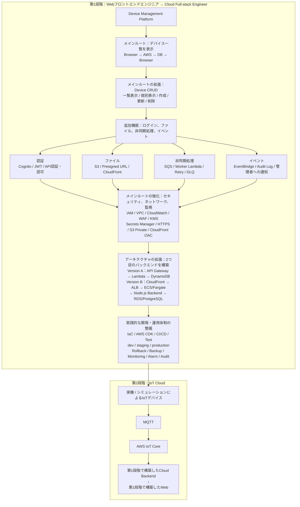

# AWS 学習ロードマップ

**補足：** Device Management Platformは基本的な機能から開発を始め、AWSの学習が深まるにつれて、機能を段階的に追加・拡張していきます。

## 重要事項

- **同じプロジェクト**：Device Management Platformを第1段階から第2段階へ拡張する。
- **図の矢印**：学習の順序を示す。第1段階はメインルートを動かしてから追加機能を組み込む。
- **第1段階**：ダミーのデバイスデータを使用する。実機・シミュレーションによるデバイスは第2段階で接続する。
- **進度と費用**：6か月以内に学習を終える期限は設けない。費用はできるだけ抑え、有料サービスの利用前に料金を説明する。

原文：[[AWS学习路线]]。
