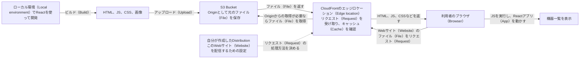
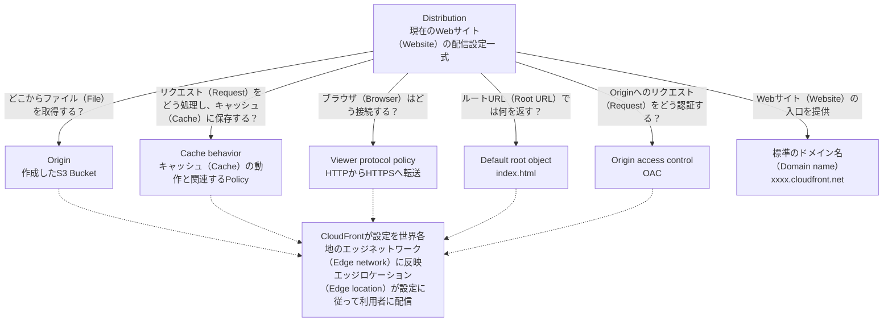
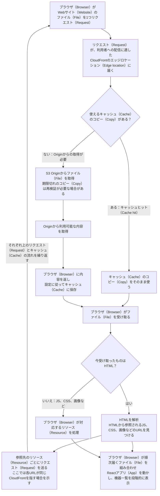
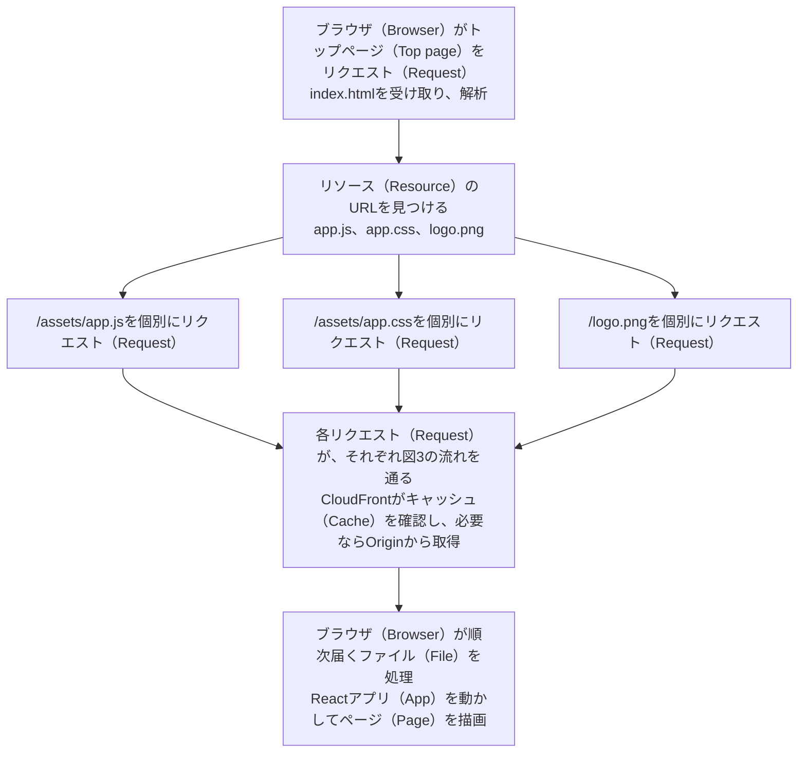
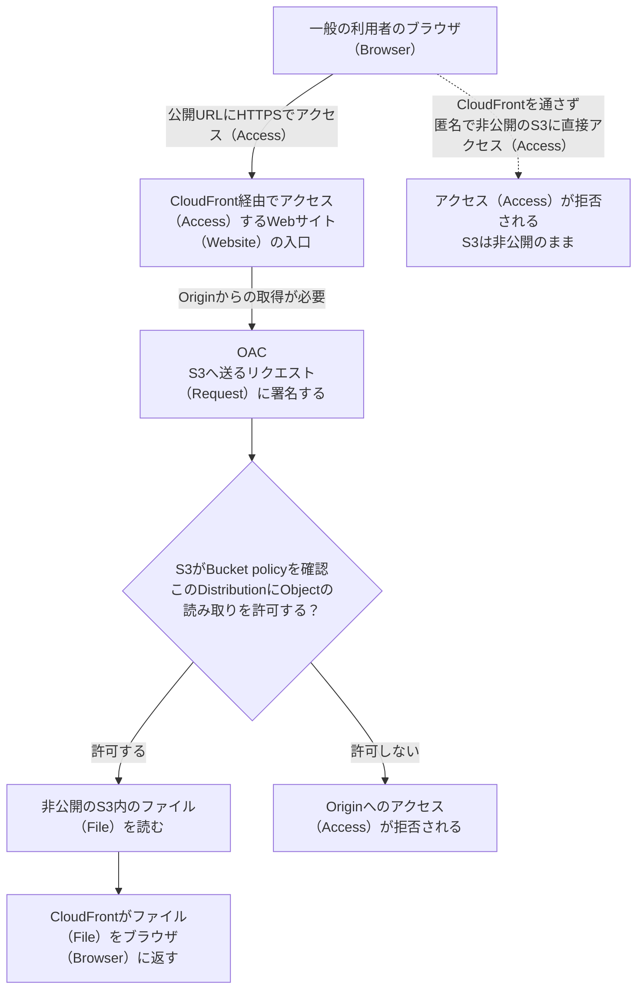
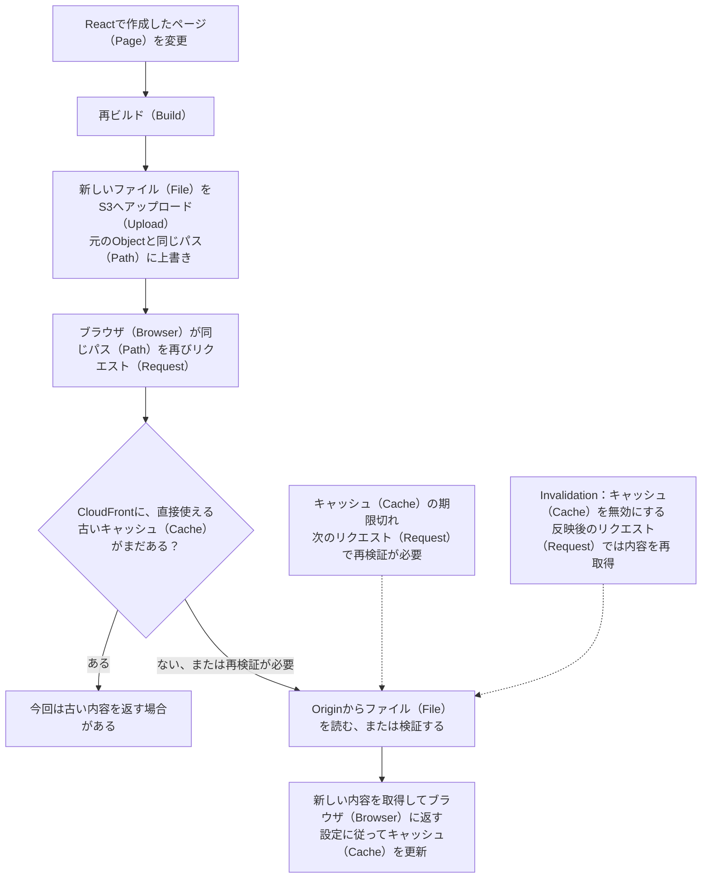
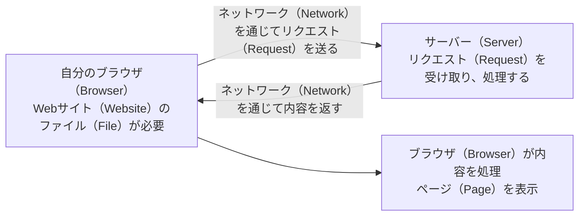
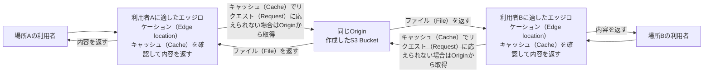
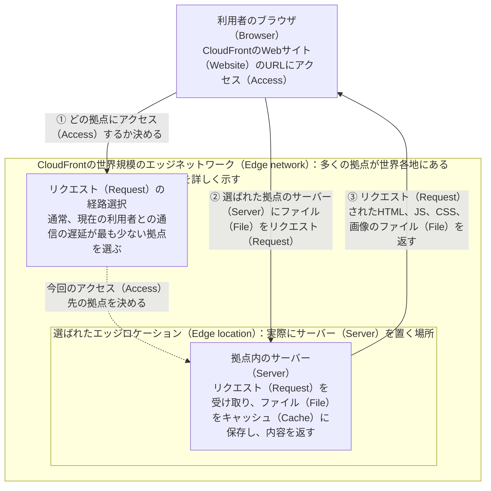

# CloudFrontの仕組みを図で理解する

現在取り組んでいるReactを使った機器管理プロジェクト（Project）を例に、全体の流れを確認してから、個々の仕組みを見ていく。まず図1で全体像（ぜんたいぞう）をつかみ、その後の図で疑問を1つずつ解消（かいしょう）していく。

**図1：全体——開発したコード（Code）が、利用者に表示されるWebサイト（Website）になるまで**

実線（じっせん）はビルド（Build）、アップロード（Upload）、リクエスト（Request）、ファイル（File）を返す流れを表す。点線（てんせん）は設定の関係を表す。S3がファイル（File）を保存し、CloudFrontが配信し、ブラウザ（Browser）がReactアプリ（App）を実行する。Distribution（ディストリビューション）は、CloudFrontがこのWebサイト（Website）をどのように配信するかを決める。

CloudFrontは[[#コンテンツ配信ネットワーク（Content Delivery Network）|コンテンツ配信ネットワーク（Content Delivery Network、CDN）]]である。[[#エッジロケーション（Edge location）|世界各地のエッジロケーション（Edge location）]]を使い、利用者への配信に適（てき）した拠点（きょてん）にリクエスト（Request）を振り分け（ふりわけ）、キャッシュ（Cache）によって[[#OriginとOriginからの取得|Origin（オリジン）からの取得]]回数を減らす。用語のリンク（Link）をクリック（Click）すると、本文の最後にある説明と図に移動できる。[AWS：CloudFrontの紹介](https://docs.aws.amazon.com/AmazonCloudFront/latest/DeveloperGuide/Introduction.html)

**図2：設定——なぜDistributionが必要なのか？**

CloudFrontは、世界中のWebサイト（Website）で利用される共通のサービス（Service）である。Webサイト（Website）ごとに、Origin、アクセス（Access）方法、キャッシュ（Cache）の設定が異なる。1つのDistributionで、現在のWebサイト（Website）のこれらの設定を管理する。

Distributionは、AWS上で管理するリソース（Resource）であり、その設定に従って[[#エッジロケーション（Edge location）|世界各地のエッジネットワーク（Edge network）]]が配信を行う。Distributionを作成すると、まず設定が各拠点に反映される。ファイル（File）は、その後のアクセス（Access）時に必要に応じて取得され、キャッシュ（Cache）に保存される。Default root objectは、Webサイト（Website）のルートURL（Root URL）にアクセス（Access）したときに、どのファイル（File）を返すかを決める。[AWS：Distributionの設定](https://docs.aws.amazon.com/AmazonCloudFront/latest/DeveloperGuide/distribution-working-with.html)、[AWS：Default root object](https://docs.aws.amazon.com/AmazonCloudFront/latest/DeveloperGuide/DefaultRootObject.html)

**図3：動作——利用者がアクセス（Access）すると、ファイル（File）はどうブラウザ（Browser）に届くのか？**

この図は、図1に出てきたCloudFrontが内部で行う判定を詳しく示す。図の上半分は、1つのファイル（File）を取得する際の流れを表す。1つのWebページ（Web page）を表示する際には、通常、このようなリクエスト（Request）が複数発生する。ここでは、キャッシュ（Cache）できる静的ファイル（Static file）へのリクエスト（Request）を例にしている。途中にあるリージョナルエッジキャッシュ（Regional edge cache）の層は省略している。

キャッシュ（Cache）があると、その後のリクエスト（Request）ではエッジロケーション（Edge location）から直接内容を取得できる場合がある。元のファイル（File）は、引き続きS3に保存されている。CloudFrontは、ブラウザ（Browser）からリクエスト（Request）が届くたびにS3へリクエスト（Request）を送るわけではない。[AWS：リクエスト（Request）とキャッシュ（Cache）の流れ](https://docs.aws.amazon.com/AmazonCloudFront/latest/DeveloperGuide/HowCloudFrontWorks.html)

**HTMLのレスポンス（Response）には、通常、HTMLそのものだけが含まれる。HTMLから参照する外部ファイル（External file）の内容は、別途取得する必要がある。** たとえば、HTML内の`<script src="/assets/app.js">`、`<link rel="stylesheet" href="/assets/app.css">`、``が示すのは、リソース（Resource）のURLである。ブラウザ（Browser）はこれらのURLを見つけた後、JS、CSS、画像をそれぞれリクエスト（Request）する。同じCloudFrontのドメイン名（Domain name）への各リクエスト（Request）では、それぞれ図3のキャッシュ（Cache）の判定が行われる。HTMLの取得でキャッシュヒット（Cache hit）しても、JS、CSS、画像の取得でもキャッシュヒット（Cache hit）するとは限らない。

この補足図は、各リソース（Resource）の関係を示している。ブラウザ（Browser）がファイル（File）を必ず1つずつ順番にダウンロード（Download）するという意味ではなく、すべてのファイル（File）がそろうまでページ（Page）を表示できないという意味でもない。ブラウザ（Browser）はリソース（Resource）を並行して取得できる。ブラウザ（Browser）内のキャッシュ（Cache）を再利用できる場合、CloudFrontにリクエスト（Request）を送る必要がないこともある。リソース（Resource）のURLが第三者のドメイン名（Domain name）を指す場合は、そのドメイン名（Domain name）にリクエスト（Request）を送る。HTML内に直接書かれた`<style>`、`<script>`、data URLの内容は、すでにHTMLに含まれているため、その部分については、別のファイル（File）をダウンロード（Download）する必要はない。[MDN：ブラウザ（Browser）がWebサイト（Website）を読み込む仕組み](https://developer.mozilla.org/en-US/docs/Learn_web_development/Getting_started/Web_standards/How_browsers_load_websites)

**図4：非公開のS3——CloudFront経由のアクセス（Access）と直接アクセス（Access）はどう違うのか？**

この図は、一般の利用者がアクセス（Access）する2つの経路を比べる。CloudFront経由で非公開のS3からファイル（File）を取得する経路と、CloudFrontを通さず、匿名でS3に直接アクセス（Access）する経路である。

OACは、CloudFrontがOriginに送るリクエスト（Request）の認証方法を定める。Bucket policyは、S3がこのDistributionにObjectの読み取りを許可するかを示す。図に示した認証と認可は確認処理を表しており、追加の2台のサーバー（Server）ではない。S3のBlock Public Accessを有効にしたまま、
一般の利用者がCloudFront経由でWebサイト（Website）にアクセス（Access）できる。[AWS：OACと非公開のS3](https://docs.aws.amazon.com/AmazonCloudFront/latest/DeveloperGuide/private-content-restricting-access-to-s3.html)

**図5：更新——再アップロード（Upload）後も、古いページ（Page）が見える場合があるのはなぜか？**

この図では、「同じパス（Path）にあるファイル（File）を上書きする場合」を例にする。S3のファイル（File）の更新と、CloudFrontのキャッシュ（Cache）に保存されたコピー（Copy）の更新は、別々の処理である。

同じパス（Path）のファイル（File）を更新するときは、キャッシュ（Cache）の有効期限やInvalidationによるキャッシュ（Cache）の無効化を考慮する必要がある。異なるファイル名（File name）で公開する方法もある。たとえば、ビルドツール（Build tool）がファイル（File）の内容に基づくハッシュ（Hash）を含むJS/CSSのファイル名（File name）を生成し、HTML内の参照も更新する。このようにファイル名（File name）でバージョン（Version）を区別する方法は、S3 VersioningによるObjectのバージョン（Version）管理とは別の概念である。ブラウザ（Browser）自体にもキャッシュ（Cache）があるが、この図はCloudFrontのキャッシュ（Cache）だけを詳しく示している。[AWS：バージョン（Version）を区別できるファイル名（File name）で内容を更新する](https://docs.aws.amazon.com/AmazonCloudFront/latest/DeveloperGuide/UpdatingExistingObjects.html)

学習中は、次の5つの問いに立ち戻ることで、理解を確認できる。ファイル（File）はどこにあるか？ 誰がブラウザ（Browser）のリクエスト（Request）を受け取るか？ どの設定が処理方法を決めるか？ CloudFrontは、どのような仕組みで非公開のファイル（File）を読めるか？ 更新後のファイル（File）は、いつブラウザ（Browser）に届くか？

## 概念の補足

本文の用語のリンク（Link）から、以下の対応する説明に移動できる。「サーバー（Server） → CDN → エッジロケーション（Edge location） → OriginとOriginからの取得」の順に読み進め、読み終えたら図1と図3に戻る。

## サーバー（Server）とデータセンター（Data center）

ブラウザ（Browser）は、ネットワーク（Network）に接続された別のコンピューター（Computer）にファイル（File）をリクエスト（Request）できる。リクエスト（Request）を受け取り、サービス（Service）を動かして内容を返すコンピューター（Computer）を、サーバー（Server）と呼ぶ。データセンター（Data center）は、多くのサーバー（Server）や通信機器などの設備をまとめて設置し、稼働させる場所である。

リクエスト（Request）と応答は、ネットワーク（Network）を通じて往復する。通信には時間がかかる。実際の待ち時間には、通信経路、混雑、接続、サーバー（Server）の処理などが影響し、地図上の距離だけで決まるわけではない。クラウドサービス（Cloud service）も、その裏側ではサーバー（Server）が処理を担っている。S3やCloudFrontを使うときは、AWSが関連するインフラ（Infrastructure）の運用を担当する。[MDN：ClientとServer](https://developer.mozilla.org/en-US/docs/Learn_web_development/Getting_started/Web_standards/How_the_web_works)

## コンテンツ配信ネットワーク（Content Delivery Network）

コンテンツ配信ネットワーク（Content Delivery Network、CDN）は、複数の場所で内容を配信するサーバー（Server）を動（うご）かし、それらが協力して利用者に内容を提供する仕組みである。インターネット（Internet）を利用して動作し、Webサイト（Website）の内容を配信する。CloudFrontは、AWSが提供するCDNサービス（Service）である。

Webサイト（Website）の元のファイル（File）は、1つの[[#OriginとOriginからの取得|Origin]]に保存されている。CDNは複数の拠点（きょてん）でリクエスト（Request）を受け付ける。利用者は遅延の少ない地点からキャッシュ（Cache）のコピー（Copy）を取得できる場合があり、遠くにあるOriginからファイル（File）を繰り返し取得する必要を減らせる。

図の2つの地点は、CDNが複数の場所から配信する仕組みを表す。リクエスト（Request）の経路選択とキャッシュ（Cache）の連携で、コンテンツ配信ネットワーク（Content Delivery Network）が成り立つ。元のファイル（File）は、引き続き1つのOriginでまとめて管理できる。[AWS：CloudFrontの紹介](https://docs.aws.amazon.com/AmazonCloudFront/latest/DeveloperGuide/Introduction.html)

## エッジロケーション（Edge location）

本文の「[[#エッジロケーション（Edge location）|世界各地のエッジロケーション（Edge location）]]」は、**CloudFrontが世界各地で実際にサーバー（Server）を設置している配信拠点**を指す。1つの拠点をエッジロケーション（Edge location、POPとも呼ぶ）という。拠点内のサーバー（Server）がブラウザ（Browser）のリクエスト（Request）を受け取り、Webサイト（Website）のファイル（File）をキャッシュ（Cache）に保存し、内容を返す。前の節のCDNの図にある、場所Aと場所Bのエッジロケーション（Edge location）も、このような拠点である。

これらの拠点を世界各地に置くことで、異なる場所の利用者が**通信の遅延が少ない拠点**から内容を取得できる。ブラウザ（Browser）が同じCloudFrontのWebサイト（Website）のURLにアクセス（Access）すると、CloudFrontのリクエスト（Request）の経路選択によって、その利用者を担当する拠点が決まる。通常は、通信の遅延が最も少ない拠点が選ばれる。「遅延が少ない」とは、ブラウザ（Browser）と拠点の間でリクエスト（Request）と応答をやり取りする待ち時間が短いということ。ここでいう「近い」は、通信の遅延が少ないことを意味する。

図の「世界規模のエッジネットワーク（Edge network）」には多くの拠点が含まれるが、ここでは現在の利用者がアクセス（Access）する1つの拠点だけを詳しく示している。「エッジロケーション（Edge location）」の枠は場所を表し、その中のサーバー（Server）がリクエスト（Request）を処理する。①は接続先の決定、②③はブラウザ（Browser）とその拠点が実際にやり取りするリクエスト（Request）と応答である。点線は選択の関係を表す。図1と図3の「CloudFrontのエッジロケーション（Edge location）」は、ここで選ばれた拠点に当たる。[AWS：エッジロケーション（Edge location）とリクエスト（Request）の経路選択](https://docs.aws.amazon.com/AmazonCloudFront/latest/DeveloperGuide/HowCloudFrontWorks.html)

## OriginとOriginからの取得

オリジン（Origin）は、CloudFrontが元の内容を取得する場所である。現在のプロジェクト（Project）では、Webサイト（Website）のファイル（File）を保存しているS3 BucketがOriginに当たる。「Originからの取得」とは、CloudFrontがリクエスト（Request）に応（こた）えるために、Originからファイル（File）を読む、またはキャッシュ（Cache）のコピー（Copy）を検証（けんしょう）する処理である。キャッシュ（Cache）でリクエスト（Request）に応（こた）えられる場合は、毎回Originから取得する必要はない。[AWS：内容の取得の流れ](https://docs.aws.amazon.com/AmazonCloudFront/latest/DeveloperGuide/HowCloudFrontWorks.html)
