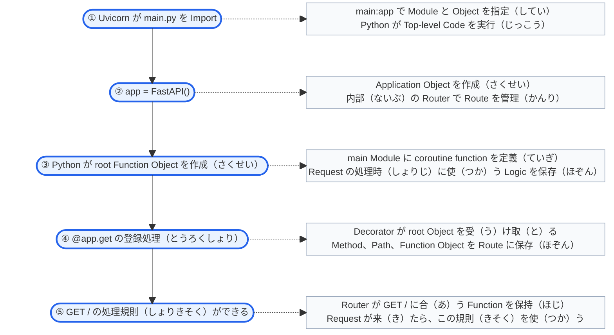
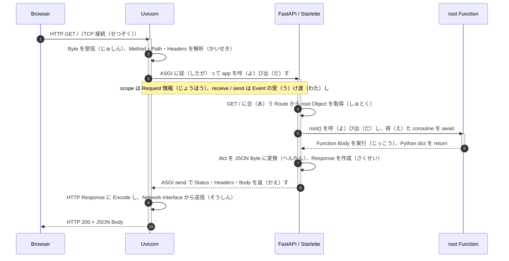

# Python と FastAPI の Request の全体（ぜんたい）の流（なが）れ

日付（ひづけ）：2026-10-15

- **Server を起動（きどう）するとき**：Python Module を読（よ）み込（こ）み、Application と Function を作（つく）り、Route を登録（とうろく）する。
- **Request を受（う）け取（と）るとき**：Route に合（あ）う Function を呼（よ）び出（だ）し、戻（もど）り値（ち）（Return Value）を HTTP Response に変（か）える。

## Server の起動時（きどうじ）：Module の読（よ）み込（こ）みと Route の登録（とうろく）

- **いつ動（うご）くか**：Terminal で Uvicorn の起動（きどう）Command を実行（じっこう）したとき。
- **何（なに）がきっかけか**：Command の `main:app` が、Uvicorn に main Module の読（よ）み込（こ）みと app Object の取得（しゅとく）を指示（しじ）する。
- **この図（ず）が示（しめ）すこと**：Server Process が main.py を Import し、Python が Module の Top-level Code を実行（じっこう）する流（なが）れ。



###### [Function の定義（ていぎ）と Route の登録（とうろく）](#registration)

## Request の受信時（じゅしんじ）：処理（しょり）と Response の返送（へんそう）

- **前提（ぜんてい）**：Application の読（よ）み込（こ）みが終（お）わり、Uvicorn が Address と Port で接続（せつぞく）を待（ま）っている。
- **図（ず）の読（よ）み方（かた）**：各列（かくれつ）は一（ひと）つの担当（たんとう）を示（しめ）す。上（うえ）から下（した）へ時間順（じかんじゅん）に読（よ）む。
- **実線（じっせん）の矢印（やじるし）**は Request や呼（よ）び出（だ）し、**破線（はせん）の矢印（やじるし）**は戻（もど）る Data を示（しめ）す。



###### [Request 処理（しょり）の実行順序（じっこうじゅんじょ）](#request-order)

###### [Socket の役割（やくわり）](#socket)

###### [ASGI と Starlette の役割（やくわり）](#asgi-starlette)

###### [Python Interpreter と非同期関数（ひどうきかんすう）（Async Function）の実行（じっこう）](#python-execution)

###### [戻（もど）り値（ち）（Return Value）と Response の変換（へんかん）](#response)

---

## 詳（くわ）しい説明（せつめい）

<a id="registration"></a>

### Function の定義（ていぎ）と Route の登録（とうろく）

**③は、Server を起動（きどう）し、main.py の Top-level Code を実行（じっこう）するときに行（おこな）われる。**

| 質問（しつもん） | 答（こた）え |
|---|---|
| Function はどこに書（か）くか？ | main.py の `async def root():` と、その下（した）の Indent した Code Block に書（か）く |
| いつ定義（ていぎ）されるか？ | Uvicorn が main Module を Import し、Python が Function の定義文（ていぎぶん）を実行（じっこう）したとき |
| 定義（ていぎ）で何（なに）ができるか？ | Server Process の Memory に coroutine function Object を作（つく）り、後（あと）で実行（じっこう）する Logic を保存（ほぞん）する |
| 名前（なまえ）はどこに保存（ほぞん）されるか？ | Decorator の処理後（しょりご）、main Module の名前（なまえ）root が Function Object に結（むす）び付（つ）く。Router もこの Object への参照（さんしょう）（Reference）を保持（ほじ）する |
| 誰（だれ）が Route を登録（とうろく）するか？ | `@app.get("/")` に対応（たいおう）する FastAPI の Decorator |
| 何（なに）を登録（とうろく）するか？ | Method は GET、Path は `/`、処理（しょり）する Function は root、という対応関係（たいおうかんけい） |
| いつ Function Body が動（うご）くか？ | Request が Route に合（あ）った後（あと）、FastAPI が root を呼（よ）び出（だ）し、得（え）た coroutine を await するとき |

**「Function の定義（ていぎ）」と「Function Body の実行（じっこう）」は、時間（じかん）も結果（けっか）も違（ちが）う。**

| 段階（だんかい） | Python がすること | `return {"message": "backend updated"}` は動（うご）くか？ |
|---|---|---|
| Server の起動（きどう）・Function の定義（ていぎ） | Function Object を作（つく）り、後（あと）で呼（よ）び出（だ）す Logic を保存（ほぞん）する | 動（うご）かない。処理（しょり）の準備（じゅんび）なので、この Request の戻（もど）り値（ち）はまだできない |
| Request の到着（とうちゃく）・Function Body の実行（じっこう） | FastAPI が root を呼（よ）び出（だ）して await し、Python が内部（ないぶ）の文（ぶん）を実行（じっこう）する | 動（うご）く。dict が FastAPI に返（かえ）り、この Request の Response に使（つか）われる |

- **定義時（ていぎじ）に保存（ほぞん）するのは Logic であり、先（さき）に計算（けいさん）した Response ではない。**
- 後（あと）で Database 検索（けんさく）（Query）を加（くわ）えた場合（ばあい）も、検索（けんさく）は Request の処理中（しょりちゅう）、Function Body の実行時（じっこうじ）に行（おこな）われる。
- 図（ず）の「Function の準備（じゅんび）→ Route の登録（とうろく）」は、登録（とうろく）の依存関係（いぞんかんけい）（Dependency）を示（しめ）す。
- Python が Decorator の式（しき）（Expression）を評価（ひょうか）（Evaluate）する細（こま）かい順序（じゅんじょ）は、この図（ず）では省（はぶ）いている。

<details>
<summary>展開（てんかい）：Decorator は Function Object をどう使（つか）うか？</summary>

理解（りかい）のための同等（どうとう）の書（か）き方（かた）。Project に追加（ついか）する必要（ひつよう）はない。

```python
async def root():
    return {"message": "backend updated"}

root = app.get("/")(root)
```

- `app.get("/")` で Decorator を得（え）る。
- `(root)` で、作成（さくせい）した Function Object を Decorator に渡（わた）す。
- FastAPI は Route を登録（とうろく）し、元（もと）の Function Object を返（かえ）す。
- Router が Object への参照（さんしょう）（Reference）を保持（ほじ）するため、Request の到着後（とうちゃくご）に取（と）り出（だ）して呼（よ）び出（だ）せる。

</details>

<a id="request-order"></a>

### Request 処理（しょり）の実行順序（じっこうじゅんじょ）

| 順序（じゅんじょ） | 担当（たんとう） | 入力（にゅうりょく）（Input）→ 処理（しょり）（Processing）→ 出力（しゅつりょく）（Output） |
|---|---|---|
| 1 | Browser | Access 操作（そうさ）を HTTP GET `/` にし、Uvicorn が接続（せつぞく）を待（ま）つ Address と Port に送（おく）る |
| 2 | Uvicorn | Network の Byte を受（う）け取（と）り、Method、Path、Headers などの Request 情報（じょうほう）を解析（かいせき）（Parse）する |
| 3 | Uvicorn | ASGI に従（したが）って FastAPI Application を呼（よ）び出（だ）し、Request 情報（じょうほう）と Event を受（う）け渡（わた）す仕組（しく）みを渡（わた）す |
| 4 | FastAPI / Starlette の Routing | Method と Path を使（つか）い、起動時（きどうじ）に登録（とうろく）した root Function Object を探（さが）す |
| 5 | FastAPI | root を呼（よ）び出（だ）し、得（え）た coroutine を await して Function Body を実行（じっこう）する |
| 6 | root | return を実行（じっこう）し、Python dict を FastAPI に返（かえ）す |
| 7 | FastAPI / Starlette | 戻（もど）り値（ち）を JSON Response に変（か）え、ASGI send で Response Event を返（かえ）す |
| 8 | Uvicorn | Event を HTTP Response に Encode し、Network Interface から Browser に送（おく）る |
| 9 | Browser | Response を受（う）け取（と）り、JSON の内容（ないよう）を表示（ひょうじ）する |

- Starlette の Middleware と Routing の基礎機能（きそきのう）が、Application 内部（ないぶ）の処理（しょり）に使（つか）われる。
- 現在（げんざい）の GET `/` には入力引数（にゅうりょくひきすう）（Input Arguments）と独自（どくじ）の Dependencies がないため、その準備（じゅんび）と検証（けんしょう）（Validation）の流（なが）れは省（はぶ）く。
- 次（つぎ）の Request も登録済（とうろくず）みの Route を使（つか）い、毎回（まいかい）main.py を Import し直（なお）すことはない。
- Server を再起動（さいきどう）したときや、開発用（かいはつよう）の Reload で Server Process が再起動（さいきどう）したときは、Module を読（よ）み込（こ）み直（なお）す。

<a id="socket"></a>

### Socket の役割（やくわり）

**Socket は、OS が提供（ていきょう）する通信（つうしん）の端点（たんてん）（Communication Endpoint）。Program は Socket を通（とお）して Byte を受信（じゅしん）・送信（そうしん）する。**

| 名前（なまえ） | 現在（げんざい）の使（つか）い方（かた） |
|---|---|
| IP Address | Network の Address。127.0.0.1 は自分（じぶん）の Computer を示（しめ）す |
| Port | Address 上（じょう）の Service の入口番号（いりぐちばんごう）。Browser と Uvicorn は同（おな）じ Port を使（つか）う必要（ひつよう）がある |
| Socket | Program が Data を受信（じゅしん）・送信（そうしん）する通信（つうしん）の端点（たんてん）。Port 番号（ばんごう）そのものではない |
| TCP | 現在（げんざい）の接続（せつぞく）で使（つか）う伝送（でんそう）Protocol。順序（じゅんじょ）のある Byte Stream を提供（ていきょう）する |
| HTTP | Byte で表（あらわ）す Request と Response の規則（きそく） |

| 段階（だんかい） | Uvicorn と Event Loop は OS の Socket をどう使（つか）うか？ |
|---|---|
| 待（ま）ち受（う）け（Listen） | Host / Port に Bind した Listening Socket を用意（ようい）し、接続（せつぞく）を待（ま）つ |
| 接続（せつぞく）の受（う）け入（い）れ（Accept） | Browser が作（つく）った TCP 接続（せつぞく）を扱（あつか）い、その接続（せつぞく）に対応（たいおう）する Socket を使（つか）う |
| 受信（じゅしん）（Receive） | 受（う）け取（と）った Byte を Uvicorn の HTTP Parser に渡（わた）す |
| 送信（そうしん）（Send） | Uvicorn が Encode した Response の Byte を OS に渡（わた）して送（おく）る |

- Listening Socket と、個別（こべつ）の接続（せつぞく）の Socket は同（おな）じ Object ではない。
- Python の socket Module は、OS の Socket 機能（きのう）を使（つか）う Interface を提供（ていきょう）する。
- Network の受信（じゅしん）・送信（そうしん）は Uvicorn とその実行環境（じっこうかんきょう）が担当（たんとう）するため、現在（げんざい）の root に Socket 操作（そうさ）を書（か）く必要（ひつよう）はない。

参考（さんこう）：[Python Socket の公式説明（こうしきせつめい）](https://docs.python.org/3.12/library/socket.html)。

<a id="asgi-starlette"></a>

### ASGI と Starlette の役割（やくわり）

| 名前（なまえ） | 何（なに）か？ | どこで働（はたら）くか？ |
|---|---|---|
| Uvicorn | ASGI Server Program | HTTP の Network 側（がわ）の処理（しょり）と Application の呼（よ）び出（だ）し |
| ASGI | Asynchronous Server Gateway Interface。Server と Application の Interface 仕様（しよう）（Specification） | Uvicorn が Request を渡（わた）す方法（ほうほう）と、Application が Response を返（かえ）す方法（ほうほう）を決（き）める |
| Starlette | 実際（じっさい）に Install する Python Web Framework / Toolkit | FastAPI に Middleware、Routing の基礎（きそ）、Request / Response などの機能（きのう）を提供（ていきょう）する |
| FastAPI | Starlette を基（もと）に作（つく）られた Web Framework | API の登録（とうろく）、Function の呼（よ）び出（だ）し、Arguments・Dependencies・Response の処理（しょり）を担当（たんとう）する |
| app | `app = FastAPI()` で作（つく）る Application Object | Uvicorn が読（よ）み込（こ）んで呼（よ）び出（だ）す Application の入口（いりぐち） |

**ASGI の呼（よ）び出（だ）しは、Process 内（ない）の Python の非同期（ひどうき）（Async）呼（よ）び出（だ）し。追加（ついか）の HTTP Request を送（おく）ることではない。**

簡単（かんたん）に表（あらわ）すと、`await app(scope, receive, send)` になる。

| 引数（ひきすう）（Argument） | Uvicorn が渡（わた）すもの | Application での使（つか）い方（かた） |
|---|---|---|
| scope | この HTTP Request の情報（じょうほう） | Method、Path、Headers などを読（よ）む |
| receive | 非同期（ひどうき）（Async）の入力関数（にゅうりょくかんすう）（Input Function） | 必要（ひつよう）なとき、Request Body などの入力（にゅうりょく）Event を待（ま）つ |
| send | 非同期（ひどうき）（Async）の出力関数（しゅつりょくかんすう）（Output Function） | Response の Status、Headers、Body などの Event を返（かえ）す |

- FastAPI Class は Starlette を継承（けいしょう）（Inherit）し、Application 内部（ないぶ）で Starlette の入口（いりぐち）と部品（ぶひん）（Components）を使（つか）う。
- Starlette のために別（べつ）の Server を起動（きどう）する必要（ひつよう）はない。
- FastAPI Class には特殊（とくしゅ）Method（Special Method）の `__call__` があるため、app Object を `app(...)` の形（かたち）で呼（よ）び出（だ）せる。
- 実際（じっさい）の呼（よ）び出（だ）しは Middleware などの Wrapper を通（とお）る場合（ばあい）がある。図（ず）は中心（ちゅうしん）となる関係（かんけい）を示（しめ）す。

参考（さんこう）：[ASGI の公式仕様（こうしきしよう）](https://asgi.readthedocs.io/en/latest/specs/main.html)。

<a id="python-execution"></a>

### Python Interpreter と非同期関数（ひどうきかんすう）（Async Function）の実行（じっこう）

| 名前（なまえ） | 現在（げんざい）の Server での役割（やくわり） |
|---|---|
| Python Interpreter | main.py、root、および Uvicorn・FastAPI・Starlette の Python Code を実行（じっこう）する |
| Event Loop | Uvicorn の実行環境（じっこうかんきょう）で動（うご）き、非同期（ひどうき）（Async）Task の実行順（じっこうじゅん）と I/O の待機（たいき）を調整（ちょうせい）する |
| Request 処理（しょり）の Task | Uvicorn が Request のために用意（ようい）する実行（じっこう）Task。Application の呼（よ）び出（だ）し全体（ぜんたい）を進（すす）める |
| FastAPI の Request 処理（しょり）Code | Route に合（あ）う root を呼（よ）び出（だ）し、返（かえ）された coroutine を await する |

- Interpreter は実行環境（じっこうかんきょう）であり、Request が次（つぎ）に通（とお）る業務処理（ぎょうむしょり）の場所（ばしょ）ではない。
- async Function の root を呼（よ）び出（だ）すと、coroutine object ができる。
- FastAPI がその coroutine を await すると、root の Function Body が進（すす）む。
- 現在（げんざい）の root はすぐに dict を返（かえ）し、外部（がいぶ）の操作（そうさ）を待（ま）たない。
- 後（あと）で root が未完了（みかんりょう）の非同期（ひどうき）（Async）I/O を await する場合（ばあい）、現在（げんざい）の Task は一時停止（いちじていし）（Suspend）できる。
- その間（あいだ）、Event Loop は実行可能（じっこうかのう）な別（べつ）の Task を進（すす）める。
- Uvicorn が Event Loop を動（うご）かすため、main.py で root を実行（じっこう）するための asyncio.run は不要（ふよう）。

参考（さんこう）：[FastAPI の非同期（ひどうき）（Async）の公式説明（こうしきせつめい）](https://fastapi.tiangolo.com/async/)。

<a id="response"></a>

### 戻（もど）り値（ち）（Return Value）と Response の変換（へんかん）

| 形（かたち） | 誰（だれ）が作（つく）る・処理（しょり）するか？ | 何（なに）を表（あらわ）すか？ |
|---|---|---|
| Python dict | root が return を実行（じっこう）したときに作（つく）る | Server Process の Memory にある Data Object |
| JSON Response の内容（ないよう） | FastAPI / Starlette が戻（もど）り値（ち）を Serialize・Encode する | Response Body として送信（そうしん）できる JSON Byte |
| HTTP Response | Application が Response 情報（じょうほう）を設定（せってい）し、Uvicorn が Encode・送信（そうしん）する | Status Code、Headers、Body からできる Response 全体（ぜんたい） |

- 現在（げんざい）、成功時（せいこうじ）の Status Code は初期値（しょきち）（Default）で 200。
- Content-Type は application/json で、Response Body の形式（けいしき）（Format）を Browser に伝（つた）える。
- Application は ASGI の http.response.start、http.response.body などの Event で Response を Uvicorn に渡（わた）す。
- return dict 自体（じたい）は、Network 送信（そうしん）を直接（ちょくせつ）行（おこな）わない。
- 現在（げんざい）は response_model を宣言（せんげん）（Declare）していないため、専用（せんよう）の出力検証（しゅつりょくけんしょう）（Output Validation）Model はまだ定義（ていぎ）していない。

参考（さんこう）：[FastAPI の Response の説明（せつめい）](https://fastapi.tiangolo.com/advanced/response-directly/)。

## 確認（かくにん）に使（つか）った資料（しりょう）

- [FastAPI：First Steps と Decorator](https://fastapi.tiangolo.com/tutorial/first-steps/)
- 手元（てもと）の実装（じっそう）（Implementation）で、FastAPI の Function 登録（とうろく）・呼（よ）び出（だ）し、Starlette の Application 入口（いりぐち）・Response 送信（そうしん）を確認（かくにん）した。
- Uvicorn の Socket の Bind、待（ま）ち受（う）け（Listen）、Request Task、HTTP Response の処理（しょり）も確認（かくにん）した。
- 本文（ほんぶん）は、現在（げんざい）の手元（てもと）の TCP / HTTP、GET `/` の成功（せいこう）する流（なが）れを説明（せつめい）する。
