# YAML と Docker Compose の設定（せってい）の基本（きほん）

この資料（しりょう）では、現在（げんざい）のプロジェクト（Project）にある `backend/compose.yaml` を例（れい）に、構成（こうせい）、設定（せってい）項目（こうもく）、読む（よむ）順番（じゅんばん）を説明（せつめい）します。

目標（もくひょう）は、**このファイル（File）を見て（みて）、何（なに）を動かす（うごかす）のか、どう接続（せつぞく）するのか、データ（Data）をどこに保存（ほぞん）するのかが分かる（わかる）こと**です。

## 1. 形式（けいしき）・ファイル（File）・ツール（Tool）を区別（くべつ）する

| 名前（なまえ） | 何（なに）か | 役割（やくわり） |
|---|---|---|
| YAML | テキスト（Text）形式（けいしき）の一つ（ひとつ） | 字下げ（じさげ）、項目（こうもく）、リスト（List）でデータ（Data）を整理（せいり）する |
| `compose.yaml` | YAML 形式（けいしき）で書く（かく）Docker Compose の設定（せってい）ファイル（File） | プロジェクト（Project）のサービス（Service）と動作（どうさ）に必要（ひつよう）な設定（せってい）を書く（かく） |
| Docker Compose | この設定（せってい）ファイル（File）を読む（よむ）ツール（Tool） | 作成（さくせい）や起動（きどう）などの操作（そうさ）を Docker Engine に依頼（いらい）する |

**YAML が決める（きめる）のは「書き方（かきかた）」、
Docker Compose が決める（きめる）のは「各（かく）項目（こうもく）の意味（いみ）」です。**

例えば（たとえば）、`image` は Docker Compose が定める（さだめる）項目（こうもく）です。すべての YAML ファイル（File）に必要（ひつよう）な項目（こうもく）ではありません。

## 2. 現在（げんざい）の設定（せってい）：全体（ぜんたい）から見る（みる）

以下（いか）は現在（げんざい）の設定（せってい）です。
```yaml
name: device-dashboard

services:
  db:
    image: postgres:17
    environment:
      POSTGRES_USER: postgres
      POSTGRES_PASSWORD: ${POSTGRES_PASSWORD:?Set POSTGRES_PASSWORD in .env}
      POSTGRES_DB: device_dashboard
    ports:
      - "127.0.0.1:5432:5432"
    volumes:
      - postgres_data:/var/lib/postgresql/data

volumes:
  postgres_data:
```

字下げ（じさげ）を見る（みる）と、次（つぎ）の構成（こうせい）になっています。

```text
Docker Compose の設定（せってい）
├── name：Compose プロジェクト（Project）の名前（なまえ）
├── services：動かす（うごかす）サービス（Service）
│   └── db：自分（じぶん）で名前（なまえ）を付けた（つけた）Database Service
│       ├── image：使用（しよう）する Docker Image
│       ├── environment：Container に渡す（わたす）環境変数（かんきょうへんすう）
│       ├── ports：Host と Container の Port の対応（たいおう）
│       └── volumes：どの Volume を Container 内（ない）のどこに Mount するか
└── volumes：使用（しよう）する名前付き（なまえつき）Volume を宣言（せんげん）
    └── postgres_data：自分（じぶん）で名前（なまえ）を付けた（つけた）保存先（ほぞんさき）
```

ここでの **Service は、Container を動かす（うごかす）ための設定（せってい）のまとまり**です。

`db` の設定（せってい）を使って（つかって）、PostgreSQL Server が動く（うごく）Container を作ります（つくります）。`db` はデータベース（Database）の名前（なまえ）ではありません。

### 項目（こうもく）の名前（なまえ）は誰（だれ）が決める（きめる）？

| 種類（しゅるい） | このファイル（File）での例（れい） | 理解（りかい）のポイント（Point） |
|---|---|---|
| Docker Compose が定める（さだめる）項目（こうもく） | `name`、`services`、`image`、`environment`、`ports`、`volumes` | 決まった（きまった）名前（なまえ）なので、自由（じゆう）に変更（へんこう）しない |
| 自分（じぶん）で付ける（つける）名前（なまえ） | `db`、`postgres_data` | 名前（なまえ）は選べる（えらべる）が、参照先（さんしょうさき）でも同じ（おなじ）名前（なまえ）を使う（つかう） |
| PostgreSQL の公式（こうしき）Image が使う（つかう）環境変数（かんきょうへんすう） | `POSTGRES_USER`、`POSTGRES_PASSWORD`、`POSTGRES_DB` | Docker Compose が Container に渡し（わたし）、Image に含まれる（ふくまれる）初期化（しょきか）プログラム（Program）が読む（よむ） |
| 設定値（せっていち） | `device-dashboard`、`postgres:17`、`device_dashboard` | 順（じゅん）に、Compose の Project 名（めい）、Docker Image とバージョン（Version）のタグ（Tag）、Database 名（めい）を表す（あらわす） |

現在（げんざい）のサービス（Service）は `db` 一つ（ひとつ）です。

追加（ついか）する項目（こうもく）は、必要（ひつよう）に応じて（おうじて）決めます（きめます）。**すべての設定（せってい）ファイル（File）に、ここにある項目（こうもく）を全部（ぜんぶ）書く（かく）必要（ひつよう）はありません。**

Docker Compose では `services` にサービス（Service）を書きます（かきます）。`name` は省略（しょうりゃく）でき、ポート（Port）の割り当て（わりあて）やストレージ（Storage）のマウント（Mount）も必要（ひつよう）に応じて（おうじて）設定（せってい）します。([Docker Compose の Service の説明（せつめい）](https://docs.docker.com/reference/compose-file/services/))

## 3. YAML の基本（きほん）の読み方（よみかた）

| 書き方（かきかた）              | 意味（いみ）                                                                           | このファイル（File）での例（れい）                            |
| ---------------------- | -------------------------------------------------------------------------------- | ---------------------------------------------- |
| `項目: 値`                | 項目（こうもく）に値（あたい）を設定（せってい）する。この例（れい）では `:`（コロン／colon）の後（あと）に空白（くうはく）を一つ（ひとつ）入れる（いれる）         | `image: postgres:17`                           |
| 字下げ（じさげ）               | 親子（おやこ）の関係（かんけい）を表す（あらわす）。同じ（おなじ）階層（かいそう）はそろえる。空白（くうはく）を使い（つかい）、Tab で字下げ（じさげ）しない | `image` は `db` の下（した）、`db` は `services` の下（した） |
| `- 内容`                 | リスト（List）の一つ（ひとつ）の要素（ようそ）。複数（ふくすう）ある場合（ばあい）は、一行（いちぎょう）ずつ書く（かく）                   | `ports` の下（した）の一つ（ひとつ）の設定（せってい）                |
| `# 説明`                 | `#` の後（あと）はコメント（Comment）。設定（せってい）としては処理（しょり）されない                                 | `image: postgres:17 # Use the official image.` |
| `"文字"`                 | 文字列（もじれつ）として書く（かく）                                                               | `"127.0.0.1:5432:5432"`                        |
| `項目:` の後（あと）に値（あたい）がない | YAML では空（から）の値（あたい）を表す（あらわす）。使える（つかえる）かどうかは、設定（せってい）を読む（よむ）ツール（Tool）による          | 最上位（さいじょうい）の `postgres_data:`                  |

**最上位（さいじょうい）の `postgres_data:` が空（から）なのは、名前付き（なまえつき）Volume を宣言（せんげん）し、Docker Compose の標準（ひょうじゅん）設定（せってい）を使う（つかう）ためです。**

「データベース（Database）にデータ（Data）がない」という意味（いみ）ではありません。([Docker Compose の Volume の説明（せつめい）](https://docs.docker.com/reference/compose-file/volumes/))

## 4. この設定（せってい）を読む（よむ）順番（じゅんばん）

**どんな Service があるか 
→ 何（なに）を動かす（うごかす）か 
→ 何（なに）を渡す（わたす）か 
→ 外（そと）からどう接続（せつぞく）するか 
→ データ（Data）をどこに保存（ほぞん）するか。**

### 4.1 `name` と `services`：どの Project の、どの Service か？

| 設定（せってい）                 | この設定（せってい）での意味（いみ）                                                                             |
| ------------------------ | ---------------------------------------------------------------------------------------------- |
| `name: device-dashboard` | Compose の Project 名（めい）。作成（さくせい）する Container、ネットワーク（Network）、Volume などをまとめて管理（かんり）するために使う（つかう） |
| `services:`              | Project の Service を宣言（せんげん）する                                                                  |
| `db:`                    | Database Service に付けた（つけた）名前（なまえ）。`docker compose up -d db` の `db` は、この Service を指定（してい）している   |

次（つぎ）の二つ（ふたつ）は別（べつ）の名前（なまえ）です。

- `device-dashboard`：Compose の Project 名（めい）。
- `device_dashboard`：PostgreSQL Server が管理（かんり）する Database 名（めい）。

### 4.2 `image`：何（なに）を動かす（うごかす）？

`image: postgres:17`

| 部分（ぶぶん） | 意味（いみ） |
|---|---|
| `postgres` | Docker Hub にある PostgreSQL の公式（こうしき）Docker Image の名前（なまえ） |
| `17` | Image の Version Tag。PostgreSQL 17 系（けい）を選ぶ（えらぶ）。特定（とくてい）のパッチ（Patch）バージョン（Version）に固定（こてい）する指定（してい）ではない |

Docker Engine は、この Docker Image から `db` Container を作成（さくせい）し、起動（きどう）します。

この公式（こうしき）Image には、PostgreSQL Server、psql クライアント（Client）、初回（しょかい）起動（きどう）時（じ）にデータベース（Database）を初期化（しょきか）する機能（きのう）が含まれています（ふくまれています）。

### 4.3 `environment`：Container に何（なに）を渡す（わたす）？

`environment` の下（した）に書いた（かいた）内容（ないよう）は、**Container 内（ない）の環境変数（かんきょうへんすう）**になります。

環境変数（かんきょうへんすう）は、**動作中（どうさちゅう）のプログラム（Program）が実行（じっこう）環境（かんきょう）から読み取れる（よみとれる）、名前（なまえ）と値（あたい）の組み合わせ（くみあわせ）**です。

| 環境変数（かんきょうへんすう） | PostgreSQL 公式（こうしき）Image の初回（しょかい）初期化（しょきか）での用途（ようと） |
|---|---|
| `POSTGRES_USER: postgres` | `postgres` という Database User を作成（さくせい）する。この User はスーパーユーザー（Superuser）権限（けんげん）を持つ（もつ） |
| `POSTGRES_PASSWORD: ...` | 上（うえ）の Database User のパスワード（Password）を設定（せってい）する |
| `POSTGRES_DB: device_dashboard` | `device_dashboard` という Database を作成（さくせい）する |

**これらはデータ（Data）ディレクトリ（Directory）が空（から）のときに使う（つかう）初期化（しょきか）設定（せってい）です。**

既存（きそん）の Database がある状態（じょうたい）で値（あたい）を変えても（かえても）、既存（きそん）の User の Password 変更（へんこう）や Database の作り直し（つくりなおし）は自動（じどう）では行われません（おこなわれません）。([PostgreSQL 公式（こうしき）Docker Image の説明（せつめい）](https://hub.docker.com/_/postgres))

#### Password の変数（へんすう）参照（さんしょう）：まずはこの形（かたち）を覚える（おぼえる）

現在（げんざい）の書き方（かきかた）：

```yaml
POSTGRES_PASSWORD: ${POSTGRES_PASSWORD:?Set POSTGRES_PASSWORD in .env}
```

| 部分（ぶぶん） | 意味（いみ） |
|---|---|
| 左側（ひだりがわ）の `POSTGRES_PASSWORD:` | Container に渡す（わたす）環境変数（かんきょうへんすう）の名前（なまえ） |
| 右側（みぎがわ）の `${POSTGRES_PASSWORD:?...}` | Docker Compose が外部（がいぶ）の変数（へんすう）を読み（よみ）、ここに値（あたい）を入れる（いれる） |
| `:?` の後（あと）の文字（もじ） | 変数（へんすう）が未設定（みせってい）、または値（あたい）が空（から）の場合（ばあい）に表示（ひょうじ）するエラーメッセージ（Error Message） |

この Project では `backend/.env` に値（あたい）を書いて（かいて）います。

現在（げんざい）のターミナル（Terminal）にも同名（どうめい）の環境変数（かんきょうへんすう）が設定（せってい）されている場合（ばあい）は、Terminal の値（あたい）が優先（ゆうせん）されます。

```text
.env が Password の値（あたい）を提供（ていきょう）
      ↓
Docker Compose が compose.yaml の変数（へんすう）参照（さんしょう）を値（あたい）に置き換える（おきかえる）
      ↓
environment の設定（せってい）で、その値（あたい）を db Container に渡す（わたす）
      ↓
PostgreSQL 公式（こうしき）Image の初期化（しょきか）プログラム（Program）が読む（よむ）
```

**`.env` があるだけで、その中（なか）の変数（へんすう）が全部（ぜんぶ）Container に渡される（わたされる）わけではありません。今回（こんかい）の Password は `environment` の項目（こうもく）を通して（とおして）渡しています（わたしています）。**

`${…}` は Docker Compose が対応（たいおう）する変数（へんすう）置換（ちかん）の書き方（かきかた）です。YAML 自体（じたい）が実行（じっこう）する機能（きのう）ではありません。([Docker Compose の変数（へんすう）置換（ちかん）の説明（せつめい）](https://docs.docker.com/reference/compose-file/interpolation/))

### 4.4 `ports`：Mac から Container にどう接続（せつぞく）する？

現在（げんざい）の設定（せってい）：`"127.0.0.1:5432:5432"`

```text
127.0.0.1                       : 5432                   : 5432
Mac の Loopback Address          Mac の Port              Container 内（ない）の Port
```

接続（せつぞく）の流れ（ながれ）：

**Mac 上（じょう）の Database Client → Mac の 127.0.0.1:5432 → Container 内（ない）の 5432 → PostgreSQL Server。**

`127.0.0.1` にバインド（Bind）すると、この公開（こうかい）Port は同じ（おなじ）Mac からだけ接続（せつぞく）できます。

昨日（きのう）使った（つかった）`docker compose exec db psql ...` は、Container 内（ない）で Client を起動（きどう）し、ローカル（Local）の Unix-domain Socket で PostgreSQL Server に接続（せつぞく）する方法（ほうほう）です。**この Port の割り当て（わりあて）は使って（つかって）いません。**

### 4.5 二つ（ふたつ）の `volumes`：データ（Data）はどこに保存（ほぞん）される？

二つ（ふたつ）とも `volumes` という名前（なまえ）ですが、設定（せってい）の階層（かいそう）と役割（やくわり）が違います（ちがいます）。

ここでの [Volume](#mac-docker-volume-map) は、Docker が管理（かんり）する永続化（えいぞくか）ストレージ（Storage）です。リンク（Link）から、資料（しりょう）の最後（さいご）にある全体（ぜんたい）の関係図（かんけいず）を開けます（ひらけます）。

| 場所（ばしょ） | 現在（げんざい）の設定（せってい） | 役割（やくわり） |
|---|---|---|
| [compose.yaml の最上位（さいじょうい）](#mac-docker-volume-map) | `volumes:` の下（した）の `postgres_data:` | `postgres_data` という名前付き（なまえつき）Volume を宣言（せんげん）する |
| [compose.yaml の `services → db` の中（なか）](#mac-docker-volume-map) | `- postgres_data:/var/lib/postgresql/data` | この Volume を `db` Container 内（ない）の指定（してい）したパス（Path）に Mount する |

Mount の設定（せってい）は、二つ（ふたつ）に分けて（わけて）読めます（よめます）。

```text
postgres_data          : /var/lib/postgresql/data
使用（しよう）する Volume   Container 内（ない）の Mount 先（さき）の Path
```

PostgreSQL Server が Container 内（ない）の `/var/lib/postgresql/data` に Database File を書く（かく）と、実際（じっさい）には Mount された Volume に保存（ほぞん）されます。

現在（げんざい）の Mac + Docker Desktop では、次（つぎ）の関係（かんけい）になります。

```text
Mac
└── Docker Desktop が管理（かんり）する Linux 仮想（かそう）マシン（Machine）
    ├── db Container
    │   └── /var/lib/postgresql/data → 下（した）の Volume を Mount する場所（ばしょ）
    └── postgres_data Volume
        └── Database File
```

**Volume のデータ（Data）は Container の書き込み（かきこみ）レイヤー（Layer）とは別（べつ）に保存（ほぞん）されます。ただし、Volume 自体（じたい）を削除（さくじょ）すると、その中（なか）のデータ（Data）も削除（さくじょ）されます。**

`postgres_data` は設定（せってい）で使う（つかう）名前（なまえ）です。

この Project で作成（さくせい）された Docker Volume の実際（じっさい）の名前（なまえ）は `device-dashboard_postgres_data` です。Docker Compose が、標準（ひょうじゅん）の動作（どうさ）として Compose の Project 名（めい）を先頭（せんとう）に付けています（つけています）。([Docker Compose の Volume の説明（せつめい）](https://docs.docker.com/reference/compose-file/volumes/))

<a id="mac-docker-volume-map"></a>

## 5. Mac・Docker Container・Volume の全体（ぜんたい）の関係（かんけい）

**現在（げんざい）の設定（せってい）で起動（きどう）できた後（あと）の関係図（かんけいず）です。大きな（おおきな）枠（わく）は動作（どうさ）する環境（かんきょう）を表し（あらわし）、矢印（やじるし）は操作（そうさ）やデータ（Data）の保存先（ほぞんさき）を表します（あらわします）。**

```mermaid
---
config: {"theme": "base", "themeVariables": {"background": "#1e1e1e", "primaryColor": "#002b49", "primaryTextColor": "#a6d6ff", "primaryBorderColor": "#24516b", "lineColor": "#999999", "secondaryColor": "#252525", "tertiaryColor": "#252525", "clusterBkg": "#252525", "clusterBorder": "#3b3b3b", "titleColor": "#eeeeee", "edgeLabelBackground": "#002438", "fontFamily": "Arial", "fontSize": "15px"}, "flowchart": {"defaultRenderer": "dagre-wrapper", "curve": "stepAfter", "nodeSpacing": 36, "rankSpacing": 75, "padding": 16, "htmlLabels": true, "useMaxWidth": true, "wrappingWidth": 700, "subGraphTitleMargin": {"top": 8, "bottom": 45}}, "themeCSS": ".node rect { rx: 18px; ry: 18px; } .label, .nodeLabel, .edgeLabel, .cluster-label { font-family: Arial, sans-serif !important; font-weight: 400 !important; } .edgeLabel foreignObject div, .cluster-label foreignObject div { width: max-content !important; max-width: none !important; white-space: nowrap !important; } .edgeLabel p, .cluster-label p { margin: 0 !important; white-space: nowrap !important; } .edgeLabel p { color: #a6d6ff; background-color: #002438; border: 1px solid #24516b; border-radius: 14px; } .cluster-label { color: #eeeeee; } .edge-thickness-thick { stroke-width: 1px !important; } .cluster-label p { font-size: 14px; line-height: 1.15; } .edgeLabel { translate: 0 -18px; }", "markdownAutoWrap": false, "htmlLabels": true}
---
flowchart TB
    subgraph MAC["使用中（しようちゅう）の Mac"]
        direction TB
        subgraph HOST["macOS：設定（せってい）を編集（へんしゅう）し、<br/>Command を入力（にゅうりょく）する場所（ばしょ）"]
            direction TB
            ENV["backend/.env<br/>設定（せってい）で使う（つかう）<br/>Password の値（あたい）"]
            FILE["backend/compose.yaml<br/>db Service・公式（こうしき）Image・<br/>環境変数（かんきょうへんすう）・<br/>Port・Mount を設定（せってい）"]
            COMPOSE["Docker Compose<br/>docker compose up -d db<br/>を受け付ける（うけつける）"]
            ENV -->|変数（へんすう）の値（あたい）を読む（よむ）| COMPOSE
            FILE -->|設定（せってい）を読む（よむ）| COMPOSE
        end

        subgraph DESKTOP["Docker Desktop が管理（かんり）する<br/>実行（じっこう）環境（かんきょう）"]
            subgraph VM["Linux 仮想（かそう）マシン（Machine）"]
                direction TB
                ENGINE["Docker Engine<br/>Container と Volume を管理（かんり）"]
                IMAGE["postgres:17 公式（こうしき）Docker Image<br/>Container を作る（つくる）ための<br/>Software のひな型（ひながた）"]
                subgraph CT["db Container：<br/>実行（じっこう）するための Instance"]
                    direction TB
                    PG["PostgreSQL Server<br/>device_dashboard Database を管理（かんり）"]
                    PATH["Container 内（ない）のアクセス（Access）先（さき）<br/>/var/lib/postgresql/data"]
                    PG -->|この Path で Database File を読み書き（よみかき）| PATH
                end
                VOL["一つ（ひとつ）の postgres_data Volume<br/>実際（じっさい）の名前（なまえ）：<br/>device-dashboard_postgres_data<br/>Docker が管理（かんり）する<br/>データ（Data）の保存先（ほぞんさき）"]
                IMAGE -->|Program と標準（ひょうじゅん）の<br/>起動（きどう）設定（せってい）を提供（ていきょう）| ENGINE
                ENGINE -->|最上位（さいじょうい）の volumes に従い（したがい）、<br/>作成（さくせい）または再利用（さいりよう）| VOL
                ENGINE -->|Container を作成（さくせい）し、<br/>中（なか）の Program を起動（きどう）| PG
                PATH ===|同じ（おなじ）保存先（ほぞんさき）を Mount。<br/>File のコピー（Copy）ではない| VOL
            end
        end

        subgraph DISK["Mac のディスク（Disk）：<br/>最終的（さいしゅうてき）な物理（ぶつり）ストレージ（Storage）"]
            RAW["Docker Desktop の仮想（かそう）ディスク（Disk）ファイル（File）<br/>Linux 仮想（かそう）マシン（Machine）の<br/>File System のデータ（Data）を保存（ほぞん）"]
        end
        FILE imageSelection@-->|使用（しよう）する Image を指定（してい）：image: postgres:17| IMAGE
        imageSelection@{ curve: bumpY }
        COMPOSE ~~~ IMAGE
        COMPOSE -->|動作（どうさ）に必要（ひつよう）な<br/>設定（せってい）を渡す（わたす）| ENGINE
        VOL -.->|Database File は最終的（さいしゅうてき）に<br/>この File の領域（りょういき）を使う（つかう）| RAW
    end

    classDef component fill:#002b49,stroke:#24516b,stroke-width:1px,color:#a6d6ff,font-weight:600;
    class ENV,FILE,COMPOSE,IMAGE,ENGINE,PG,PATH,VOL,RAW component;
    style MAC fill:#202020,stroke:#353535,stroke-width:1px,color:#eeeeee
    style HOST fill:#252525,stroke:#3b3b3b,stroke-width:1px,color:#eeeeee
    style DESKTOP fill:#252525,stroke:#3b3b3b,stroke-width:1px,color:#eeeeee
    style VM fill:#292929,stroke:#404040,stroke-width:1px,color:#eeeeee
    style CT fill:#303030,stroke:#444444,stroke-width:1px,color:#eeeeee
    style DISK fill:#252525,stroke:#3b3b3b,stroke-width:1px,color:#eeeeee



```



### 設定（せってい）の記述（きじゅつ）と実際（じっさい）のものを対応（たいおう）させる

| 見ている（みている）もの | 実際（じっさい）は何（なに）か？ |
|---|---|
| `compose.yaml` 最上位（さいじょうい）の `volumes:` | 使用（しよう）する名前付き（なまえつき）Volume を宣言（せんげん）する設定（せってい）項目（こうもく）。「最上位（さいじょうい）」は YAML で字下げ（じさげ）していない階層（かいそう）のことで、フォルダー（Folder）ではない |
| `services.db.volumes` | どの Volume を、その Service の Container 内（ない）のどの Path に Mount するかを Docker Engine に伝える（つたえる）設定（せってい）項目（こうもく） |
| `postgres_data` Volume | Docker が管理（かんり）する一つ（ひとつ）の Storage。現在（げんざい）は Docker Desktop の Linux 仮想（かそう）マシン（Machine）内（ない）に保存（ほぞん）される |
| `/var/lib/postgresql/data` | 同じ（おなじ）Volume に db Container 内（ない）からアクセス（Access）するための場所（ばしょ）。PostgreSQL Server はここで Database File を読み書き（よみかき）する |
| Docker Desktop の仮想（かそう）Disk File | Mac の Disk 上（じょう）にあり、Linux 仮想（かそう）マシン（Machine）の File System のデータ（Data）を保存（ほぞん）する。`postgres:17` の Software Image とは別（べつ）のもの |

**二つ（ふたつ）の `volumes` は、役割（やくわり）が違う（ちがう）二つ（ふたつ）の設定（せってい）です。最終的（さいしゅうてき）には同じ（おなじ）一つ（ひとつ）の Volume を使います（つかいます）。**

**Container 内（ない）の Path と Container 外（がい）の Volume からアクセス（Access）するのは、同じ（おなじ）Database File です。二つ（ふたつ）のコピー（Copy）を保存（ほぞん）しているわけではありません。**

`db` は Service 名（めい）です。Project 内（ない）に `db` という Folder が必要（ひつよう）、という意味（いみ）ではありません。

また、Container は、すべての内容（ないよう）を一つ（ひとつ）に包んだ（つつんだ）普通（ふつう）の Project File ではありません。

参考（さんこう）：[Docker Volume の保存先（ほぞんさき）と Mount の説明（せつめい）](https://docs.docker.com/engine/storage/volumes/)、[Docker Desktop for Mac の仮想（かそう）Disk の説明（せつめい）](https://docs.docker.com/desktop/troubleshoot-and-support/faqs/macfaqs/)。
