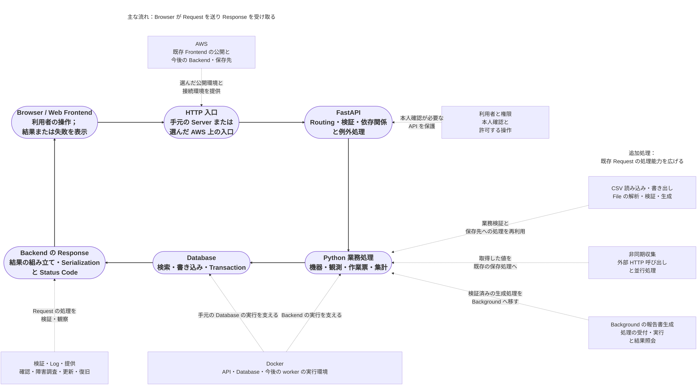
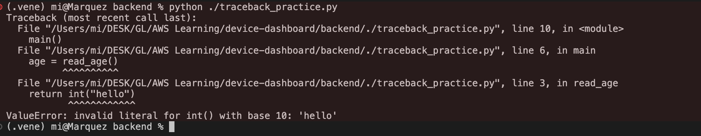

# 機器管理システム（System）：開発順序と学習手順

更新日：2026-10-13｜対象：`AWS Learning/device-dashboard`

本文は、実践を通して関連技術を学ぶための、機器管理の開発・学習一覧です。既存の Frontend を出発点に、**Python、FastAPI、Docker、AWS** を一つの開発対象にまとめます。機能の範囲、実装順序、必要な知識、確認する結果を明確にし、実際の開発、改修、検証、公開、障害調査を少しずつ身につけます。

**使い方：** 最初に全体の流れと順序表を見て、対象の手順に進みます。「実践 → 知識の確認 → 結果の検証」の順で進め、実施状況をそれぞれチェック（Check）し、問題を記録します。学習準備を最初に置き、その後は開発上の依存関係に沿って、主な流れ、追加処理、実行環境の整備を組み合わせます。

**調整方針：** 実施中に、具体的な手順、使用する道具、細部を少し調整する場合があります。同じ開発対象で、Web Request に沿って段階的に広げる大きな方向は変えません。補足説明と参考資料は文末にまとめます。

## 1. 全体の進め方

「Browser から Request を送る → Backend で処理する → Browser に返す」を中心に考えます。主な流れで業務処理を一巡させ、追加処理で機能を広げ、Docker と AWS が実行環境を支えます。図の太い実線は主な流れ、破線は追加処理または実行支援との関係を示します。

## 2. 開発順序

現在は静的 Frontend の Build、S3 / CloudFront での公開と更新まで完了しています。機器一覧はまだ固定値を使っています。今回残した学習準備を行った後、API 開発を進めます。完了済みの AWS 段階は記録を残し、やり直す必要はありません。下表は開発順序であり、すべての Request が通る順序ではありません。

| 順序 | 主な流れ：画面 → Python / FastAPI → 保存先 → 画面 | 追加処理：対応する箇所に接続 | 実行環境の整備と今回の結果 |
|---|---|---|---|
| 0 | — | Python の小さな非同期実験 | 実行順序と待機を理解する。業務機能や AWS 資源はまだ増やさない |
| 既存段階 | 手元の静的な機器一覧 → Build 成果物 | — | 非公開 S3 → CloudFront 公開 → 更新と Cache 確認。全手順と元の学習記録は第 3 節の冒頭に記載 |
| 1 | Device List：API の固定値 → Browser から実際に Request → Database 検索 | — | 接続しながら手元の環境、設定、Log、最小限の API 検証を整える |
| 2 | 機器追加：送信と検証 → 実際に保存 → 再検索 | — | 最初の読み書きを一巡させ、失敗と永続化を確認 |
| 3 | 同じ検索・追加機能を再利用 | — | API Container → API + Database の Compose。機能は変えない |
| 4 | 公開済み Frontend から実際の Backend を呼ぶ。まず読み取り専用を公開 | — | 費用と AWS 構成を確認し、公開・更新・旧版への復帰を実施 |
| 5 | 詳細 → 編集 → 保管扱いへの変更 → 絞り込み・並べ替え・件数分割 → 一つの項目改修 | — | 小さな機能ごとに一巡させる。全 API の完成後にまとめて接続しない |
| 6 | 観測記録：見本 → 実際に保存 → 機器と時刻で検索 | — | 後の読み込み・収集・集計で、同じ記録と規則を使う |
| 7 | 観測の保存・検索を再利用 | CSV：手元で解析 → Browser から Upload → 書き出し | File 入力を Python の検証へ、出力を Download 応答へ接続 |
| 8 | 観測の保存・検索を再利用 | 収集：一つの外部 Request → 複数機器を並行処理 | 所要時間を比較し、Timeout・一台の失敗・後片付けに対応 |
| 9 | 既存の業務 API に本人確認と権限確認を追加 | Login → 役割・対象ごとの権限 → 操作記録 | Server 側の認証・認可を確認後、保護した書き込み機能を公開 |
| 10 | 作業票：作成 → 状態処理 → 担当者 → 関連検索 | 利用者と権限を再利用 | 機器・利用者・Transaction・業務規則を組み合わせる |
| 11 | 実際の集計 → 同期で報告書を生成・取得 | 応答後に実行 → 永続化した Task と独立 worker | 先に内容の正しさを確認し、その後に実行方法と復旧能力を変える |
| 12 | 一つの実際の改修で提供と障害調査を一巡 | 既存機能を再利用 | 自動検証・公開・監視・旧版への復帰・復旧。既存の検証と Log も改善 |
| 13 | 実際の問題に合わせて既存機能を拡張 | 大容量 File・信頼性のある Task・即時の状態表示など | 任意の拡張。現在の基本開発の前提にはしない |

## 3. 開発と学習の手順

### 0. 学習準備｜Python の小さな非同期実験

今回はこの学習準備を残します。小さな実験で非同期を理解し、第 8 段階で実際の収集に使います。開発全体に必須の事前講座ではなく、すべての非同期機構を先に学ぶ必要はありません。

> - [ ] **0.1 最小限の基礎と実行順序**
>     - **実践の大きな手順（上から順に実施）**
>         - [x] 独立した Python 実験の実行環境を準備する。関数、import、例外の読み方は実験に必要な範囲で補う
>         - [x] 通常の関数呼び出し、coroutine の作成、await、create_task の実行順序を比較する
>         - [x] 順番に待つ場合と並行して待つ場合を比較し、同じ処理の JS 実験と見比べる
>     - **知識項目**
>         - **Python · 実行と関数**
>             - [x] Interpreter と仮想環境：使っている Python と依存関係を確認する
>               - [x] Interpreter：python が実際（じっさい）に使（つか）う Python の場所（ばしょ）とバージョン（Version）を確認（かくにん）する。
>               - [x] 仮想環境（かそうかんきょう／Virtual environment）：プロジェクト（Project）ごとに依存（いぞん）パッケージ（Dependency packages）を分（わ）け、ほかの環境（かんきょう）への影響（えいきょう）を防（ふせ）ぐ。
>               - [x] 有効化（ゆうこうか／Activation）：現在（げんざい）のターミナル（Terminal）の PATH を変更（へんこう）し、仮想環境（かそうかんきょう）の Python を優先（ゆうせん）する。alias がある場合（ばあい）は、実際（じっさい）に使（つか）われる Python も確認（かくにん）する。
>             - [x] 関数と Module の import：実験の入口と呼び出される処理
>             - [x] Traceback：例外が起きた呼び出し箇所を見つける
>                 - [x] **Traceback とは：例外（れいがい）が起（お）きるまでの呼（よ）び出（だ）しを確認（かくにん）する**
>
>                   
>
>                   `try / except` を書（か）かなくても、処理（しょり）されない例外（れいがい）があると Python が Traceback を表示（ひょうじ）する。この例（れい）では `int("hello")` が文字列（もじれつ）を整数（せいすう）に変換（へんかん）できない。
>                 - [x] Exception：例外（れいがい）そのものと、raise による例外（れいがい）の発生（はっせい）。
>                 - [x] try / except / else / finally：例外（れいがい）の処理（しょり）と後片付（あとかたづ）け。
>                 - [x] Logging：実行状況（じっこうじょうきょう）や例外（れいがい）の記録（きろく）。
>         - **Python · asyncio**
>             - [x] coroutine：async def の呼び出しで作られる、完了を待てる Object
>             - [x] await：待機可能な Object の完了を待つ
>             - [x] Event Loop：非同期 Task の実行と待機を管理する
>             - [x] Task / create_task：coroutine を Task として実行予定に入れる
>             - [x] 逐次と並行：待つ位置と Task を開始する時点
>         - **JavaScript · 比較**
>             - [ ] Promise と coroutine / Task：作成・実行・待機の動作の違い
>     - **関係：** 独立した実験で動作を理解し、第 8 段階の実際の HTTP 収集で使う。
>     - **達成条件：** 出力と所要時間を予想してから実行で確認でき、自分で変更して結果を説明できる。
>     - **学習記録：** 日付｜状態｜実験の場所｜結果と記録：

> - [ ] **0.2 失敗・Blocking・後片付け**
>     - **実践の大きな手順（上から順に実施）**
>         - [x] Blocking と非 Blocking の待機を比べ、他の Task が実行を続けられるか観察する
>         - [x] 失敗と Timeout を加え、gather と TaskGroup の処理をそれぞれ確認する
>         - [x] 実行中の Task を取り消し、後片付けが実行されることを確認する
>     - **知識項目**
>         - **Python · asyncio**
>             - [x] Blocking 呼び出し：Event Loop の Thread を占有したときの他の Task への影響
>             - [ ] gather：並行処理の結果収集と例外の伝播
>             - [ ] TaskGroup：Task 群の完了・例外・取り消し
>             - [x] timeout：待ち時間の上限を設ける
>             - [x] CancelledError：取り消しの伝播と正しい処理
>         - **Python · 資源管理**
>             - [x] try / except / finally：失敗処理と後片付け
>             - [ ] async with：非同期処理で使う資源の作成と解放
>     - **関係：** 失敗や取り消しで実行経路が変わっても、後片付けは必要。非同期の並行処理と、信頼性のある Background Task は同じではない。
>     - **達成条件：** 失敗がどの Task に影響するか説明でき、Timeout・取り消し後に資源が正しく解放されることを確認できる。
>     - **学習記録：** 日付｜状態｜実験の場所｜結果と記録：

### 既存段階｜Frontend の作成、AWS 公開と更新

この段階では静的 Frontend の公開と更新が完了しています。以下は元の AWS 手順、実施印、記録を引き継いだものです。未完了の知識項目も残します。

順序：手元の静的な機器一覧 → Build 成果物 → 非公開 S3 → CloudFront 経由の閲覧 → 修正して再公開 → Cache 更新の確認。

> - [ ] **主な流れ：Device List を動かす**
>     - [ ] **静的な成果物を AWS に公開する**
>         - **実践の大きな手順（上から順に実施）**
>             - [x ] 手元で動く静的な機器一覧を準備し、Frontend の Build 成果物を作る
>             - [ x] 公開先の Region を選び、Build 成果物を非公開 S3 に保存する
>             - [ x] S3 を Origin にする CloudFront Distribution を作り、Origin への権限と画面の入口を設定する
>             - [ x] Browser で公開画面を開き、画面と静的資源の Request が返る経路を見る
>             - [x] 画面を修正して再公開し、File 更新と Cache の関係を体験する
>         - **知識項目（この手順で実際に使う内容）**
>             - **Frontend · Build と Deploy**
>                 - [x] 静的な Build 成果物：HTML、JS、CSS と資源への Path
>                 - [x] SPA Routing：画面内の移動と URL の直接指定の違い（使用する場合）
>             - **AWS · Region**
>                 - [x] Region（地域）：公開先の選択と Region に属する資源
> 	                - [Later] Region に属する資源
>             - **AWS · Amazon S3**
>                 - [x] Bucket：Build File の保存先と所属 Region
>                 - [x] Object / Object Key：File の内容、Object 名、接続先の Path
					- [note] Object の完全な Key を確認し、File Path との関係を理解できる
					- [note] **Key は大文字・小文字を区別する**：`app.js` と `App.js` は別の Object。
					- [note] **同じ Bucket 内では、完全な Key が Object を識別する**：`assets/app.js` と `backup/app.js` は共存できる。
>                 - [x] Object の Upload と上書き：手元の Build 成果物を S3 へ反映する方法
>                 - [x] Content-Type：HTML、JS、CSS の応答形式 - - - [note] これは Browser の内容ではないのか。なぜここに置くのか。
> 	                - [note] S3 は File の内容に加えて Content-Type を Object の Metadata に保存し、読み取り時の HTTP Response に使う。 -- - - > 確認方法：S3 → 対象 Bucket → Objects → `index.html` → Properties → System and user-defined → `Content-Type` 行の Value。Browser が現在の Object を取得した際の Response Headers の Content-Type に当たる。つまり、Content-Type は返す内容の種類を Browser に伝える。
>                 - [x] Block Public Access：Bucket と Object を直接公開しないための設定 - - - [note] 詳しくはまだ見ていないが、初期状態で有効で、現在の S3 Bucket 内を非公開に保てると理解している。AWS の外部から権限のない URL で開いても取得できない。
>             - **AWS · IAM と S3 の権限**
>                 - [x] IAM Principal：作成・Upload・設定を行う主体 - - - ❓❓❓
> 	                - [note] この項目の意味：以前 AWS を操作したのはどの主体か。その操作はなぜ許可されたのか。
> 	                -  [note] 回答：touzui-learning という IAM user で操作した。この IAM user の Policy に最大の権限を付けたため許可された。（確認には aws sts get-caller-identity を使い、戻り値の Arn を見た。"Arn": "arn:aws:iam::853900965180:user/touzui-learning"）
> 	                - [note] この IAM user が <u>Principal</u>。権限を与える <u>Policy</u> は、AWS が Upload を許可するか判断する根拠の一つ。
>                 - [x] IAM Policy：Action、Resource、Effect と操作権限 - - - - [note] 最大の権限を付けており、この部分はまだ深く理解していない❄️❄️❄️
> 	                - [ ] Policy、Statement、Action、Resource、Effect を説明できる。
> 	                - [ ] ListBucket、GetObject、PutObject、DeleteObject を区別できる。
> 	                - [ ] Policy がどの User / Role に適用されるか確認できる。
> 	                - [ ] 初期状態では拒否され、Explicit Deny が優先することを理解している。
> 	                - [ ] 実際に使った AdministratorAccess と IAMUserChangePassword で、三つの項目と二つの Policy の関係を説明できる。
>                 - [x] S3 Bucket Policy：指定した CloudFront Distribution に Object の読み取りを許可する - - - - - - [note] 現在は AWS で CloudFront を作る際に自動設定でき、手動操作は不要❄️❄️❄️
>             - **AWS · Amazon CloudFront**
>                 - [x] Distribution：公開する Web の配信設定と Domain
>                 - [x] Origin：配信元になる S3 Bucket
>                 - [ ] Origin Access Control（OAC）：CloudFront が非公開 S3 に送る Request の認証
>                 - [x] Default Root Object：Root Path への Request で使う入口 File - - - [note] 任意項目だが、確認済みの最初の File 名を指定すると、閲覧時にその名前を入力しなくてよいので便利。
>                 - [ ] Viewer Protocol Policy：Browser からの HTTP / HTTPS 接続方針
>                 - [x] Edge Locations：利用者の Request を受け、内容を Cache に保存する。CloudFront が振り分けるため手動作成は不要 - - - [note] 関連する概念は理解した。
>                 - [x] Cache Behavior：Request Path に対応する Origin と Cache 設定
> 	                - [note] 対応する文書を作成した。
>                 - [ ] Cache Policy / TTL：Cache Key と有効期間
>                 - [x] Cache Hit / Miss：Cache が使える場合と、使えず Origin へ取得する場合 - - - [note] 概念を学んだ。手動で内容を更新した際にも実際に理解した。
>                 - [x] Invalidation：Cache を無効にし、更新後の File を再取得させる - - - [note] 手元の Terminal から CloudFront invalidation を実行し、AWS 内でも記録を確認した。
>                 - [x] File 名による版管理：新しい Path で新しい File を公開する方法と、Cache 無効化との違い
> 	                - [note] **File 名による版管理**：更新後に古い Cache を読まないよう、版番号や Hash を File 名に含めて画面の参照先を更新する。Browser は新しい URL で新しい File を取得でき、古い Cache の期限切れを待たなくてよい。
> 	                - [note] **現在の実装**：Vite Build が Hash 付きの JS・CSS File 名を自動生成し、`index.html` の参照先も更新する。
> 	                - [note] **違い**：File 名による版管理は URL を変えて古い Cache を避ける。Invalidation は元の URL の CloudFront Cache を無効にする。S3 Versioning は同じ Object Key の複数の版を保存し、古い内容を取り戻せるようにするが、CloudFront Cache は自動更新しない。
> 		                - [Later] S3 Versioning の実現方法と実践❄️❄️❄️
> 	                - [note] **公開時の組み合わせ**：JS・CSS は新しい URL を使う。名前が変わらない `index.html` は Cache を適切に更新し、Browser が新しい資源を取得できるようにする。
>                 - [ ]  [Later] Custom Error Responses：SPA の URL を直接開いた場合の処理（使用する場合） - - - まだ遭遇していないため、必要になった時点で学ぶ❄️❄️❄️
>             - **通信 · DNS、HTTPS、HTTP**
>                 - [ ] DNS：CloudFront の名前解決と Request の振り分け - - - [note] 概念を学び、文書にまとめた。
>                 - [ ] HTTPS / TLS：Browser と CloudFront 間の暗号化された接続
>                 - [ ] HTTP GET：入口 File と静的資源の取得
>                 - [ ] HTTP Status Codes：200、403、404 などの結果と調査方法
>                 - [ ] Cache-Control：Response Header に含まれる Cache の指示
>             - **Browser · 資源の読み込みと Cache**
>                 - [ ] HTML 解析と資源の読み込み：画面が JS・CSS・画像を取得する方法 - - - AWS 固有ではなく、もともと理解しているため確認していない。
>                 - [ ] Browser Cache：CloudFront Cache との違いと画面更新への影響
>                 - [x] DevTools Network：URL、Status Code、Response Header、Cache の取得元を見る
>         - **関係：** Browser → CloudFront。Cache Hit なら直接返し、Miss なら S3 から読み取って返す。
>         - **達成条件：** 公開画面を開けて更新が反映される。保存場所、接続、認可、Cache の関係を説明できる。
>         - **学習記録：**

**次への接続：** S3 / CloudFront の公開方法を維持し、Frontend の固定値を FastAPI の戻り値へ少しずつ置き換える。

### 1. 主な流れ｜現在の機器一覧を Backend までつなぐ

現在の課題：画面には Frontend の Source Code に書いた記録しか表示できません。実行環境 → API の固定値 → 画面からの Request → Database 検索 → Request の障害調査の順で進め、一度に一つの取得元を置き換えます。

> - [ ] **1.0 起動して変更できる Python Backend を準備する**
>     - **実践の大きな手順（上から順に実施）**
>         - [x] 既存の backend 配下に Python 仮想環境を準備する。この段階で必要な FastAPI と ASGI Server を導入し、依存関係と起動命令を記録する
>         - [x] 最小限の入口を作って起動する。一か所の応答を変更し、自分の実装が動いていることを確かめる
>         - [x] 作業 Directory、Interpreter、待ち受け Address と Port を記録する。import または Port の失敗を一度起こして原因を調べる
>     - **知識項目（この手順で実際に使う内容）**
>         - **Python · 環境と実行の入口**
>             - [x] Interpreter / venv：使用する Python と依存関係の分離
>             - [x] pip / 依存する版の記録：Library を導入し、他の人も環境を再現できるようにする
>             - [x] Module / Package / import：Server が Application Object を読み込む方法
>             - [x] 関数 / return / list / dict：既存の機器例を戻り値として組み立てる
>             - [ ] Traceback：例外の履歴から問題の File と呼び出し位置を見つける
>         - **Python Web / 設定**
>             - [x] Uvicorn / ASGI の入口：Server を起動し FastAPI Object を読み込む
>             - [x] 待ち受け Address と Port：Process の起動と Browser からの接続可否を区別する
>             - [x] 開発時の再読み込み：修正後に読み込み直す動作と本番の実行方法の違い
> 	            - [x] 開発時の  `--reload`
> 	            - [x] 本番環境（ほんばんかんきょう）には、`--reload`が使わない
>             - [x] 環境変数：API や Database の環境差を保存する。秘密の値は Frontend に書かない
>     - **関係：** 既存 Frontend は維持し、まず Python Backend を単独起動できるようにして、その後に機器 API を追加する。
>     - **達成条件：** 自分で起動・停止・修正・再起動でき、起動失敗の原因を一つ見つけられる。
>     - **学習記録：** 日付｜状態｜実装 / Request / 検証記録｜結果と記録：

> - [ ] **1.1 FastAPI から固定の見本を返す**
>     - **実践の大きな手順（上から順に実施）**
>         - [x] backend に最小限の実行可能な Application を作り、既存 Frontend は維持する
>         - [x] GET /devices を用意し、既存の id・name・status に合う見本を先に返す
>         - [x] API 文書と直接の HTTP Request で確認し、見本を変更して応答の変化を見る
>     - **知識項目**
>         - **Python · 値の組み立て**
>             - [x] list / dict：機器の集合と一件の記録を表す
>             - [x] 関数と Module：API 処理の入口を整理する
>             - [x] 型注釈：引数と戻り値の型を示す。実行時の検証の代わりではない
>         - **FastAPI / Python Web · API の実行**
>             - [x] Path Operation Function：HTTP Method と Path に対応する関数
>             - [x] OpenAPI：API の構造と自動文書
> 	            - [x] OpenAPI が API のパス（Path）・パラメーター（Parameter）・レスポンス（Response）などを記述（きじゅつ）するための仕様（しよう）であることを理解（りかい）する。
				   - [x] `/openapi.json` で、FastAPI が生成（せいせい）した API 定義（ていぎ）を確認（かくにん）する。
				   - [x] `/docs` がその定義（ていぎ）を読み込み（よみこみ）、操作（そうさ）できる API ドキュメント（Document）として表示（ひょうじ）することを理解（りかい）する。
				   - [x] `/docs` で各（かく）API の HTTP メソッド（Method）・パス（Path）・パラメーター（Parameter）・レスポンス（Response）の定義（ていぎ）を確認（かくにん）する。
				   - [x] `Try it out` → `Execute` で実際（じっさい）にリクエスト（Request）を送り（おくり）、ステータスコード（Status Code）・レスポンス本文（ほんぶん／Response Body）・ヘッダー（Header）を確認（かくにん）する。
				   - [x] ドキュメント（Document）のレスポンス例（れい／Response Example）と、実際（じっさい）のリクエスト（Request）で返された（かえされた）結果（けっか）を区別（くべつ）する。
>             - [x] Uvicorn：ASGI Application を動かす Server
>             - [x] ASGI：Server と Python Web Application 間の接続仕様。自分で Protocol を実装する必要はない
> 	            - [x] 現在のプロジェクトで、Uvicorn がサーバー、FastAPI の `app` が ASGI アプリケーションであることを理解する。
> 	            - [x] ASGI が、サーバーからアプリケーションを呼び出し、リクエストとレスポンスの情報をやり取りするための仕様であることを理解する。
> 	            - [x] 現段階では FastAPI のルートを実装できればよく、ASGI 自体の実装や内部パラメーターの暗記は不要であることを確認する。
>         - **HTTP · 応答**
>             - [x] JSON / Content-Type：応答の内容と形式の宣言
>     - **関係：** HTTP Request → Uvicorn → FastAPI Routing → 固定の見本 → JSON Response。
>     - **達成条件：** API を単独で起動・呼び出しでき、見本の変更が応答に反映される。Database はまだ不要。
>     - **学習記録：** 日付｜状態｜実装または Request の記録｜結果と記録：

> - [x] **1.2 手元の Frontend を実際の Request に切り替える**
>     - **実践の大きな手順（上から順に実施）**
>         - [x] 既存一覧の取得元を Source Code 内の定数から API Request に変える
>         - [x] 読み込み中・空の一覧・Request 失敗の表示を加え、実際に起きた Cross-origin の問題を処理する
>         - [x] Backend の見本を変えて再取得し、Browser の結果と Backend の Log を対応づける
>     - **知識項目**
>         - **HTTP / Browser · Request の経路**
>             - [x] Request URL / Method / Status Code：実際に呼んだ API と結果を識別する
>             - [x] Origin / Same-origin Policy：Protocol・Host・Port で決まる呼び出し元
>             - [x] DevTools Network：Request と Response を見る
>             - [x] CORS / Preflight Request：Browser の Cross-origin 確認と Server 側の許可範囲
>         - **FastAPI / Backend · 実行の観察**
>             - [x] CORSMiddleware：実際に必要な Origin を許可する
>             - [x] Access Log と例外 Log：Request が届いたことと処理が失敗したことを区別する
> 	            - [x] OK:  " INFO: 127.0.0.1:52314 - "GET /devices HTTP/1.1" 200 OK "
> 	            - [x] Error:   " INFO: 127.0.0.1:52314 - "GET /devices HTTP/1.1" 500 Internal Server Error   ...  ""
>     - **関係：** 手元の Browser → 手元の API → 見本 → 画面。既存の S3 / CloudFront 公開は維持する。
>     - **達成条件：** API の値が画面に表示され、停止時には失敗を確認できる。Browser と Backend のどちらで問題が起きたか説明できる。
>     - **学習記録：** 日付｜状態｜Request または画面の記録｜結果と記録：

> - [ ] **1.3 固定値の取得元を Database 検索に置き換える**
>     - **実践の大きな手順（上から順に実施）**
>         - [x] 手元の PostgreSQL を起動し、接続先と独立した開発用 Database を用意する。Container を使う場合も、まず必要最小限の操作だけ行う
>         - [x] 現在の機器項目に合わせて最小限の表構造と最初の Migration を作り、少量の見本を保存する
>         - [x] FastAPI から Database を検索し、現在の API 形式を維持する
>         - [x] 保存した記録を変更して再検索し、画面の結果を確認する。再起動後も読む
>         - [x] 空の表と接続失敗を確認し、Database Session を解放する
>     - **知識項目**
>         - **PostgreSQL / SQL · 保存する情報**
>             - [x] 表 / 行 / 列：永続化する記録の構成
>             - [x] 主キー（Primary Key）：機器を一意に識別する
>             - [x] SELECT：記録を検索する
>         - **SQLAlchemy / Alembic · Database 接続**
>             - [x] Database Driver / 接続 URL：Python は Driver で指定の Database に接続し、認証情報は Backend 設定から取得する
>             - [x] ORM Model：Python Object と Database の表の対応
> 	            - [x] ORM（Object-Relational Mapping）は、Python のオブジェクト（Object）とデータベース（Database）の表（ひょう）・列（れつ）を対応（たいおう）させる仕組（しく）みです。Django にも ORM があります。このプロジェクト（Project）で使（つか）っているのは、SQLAlchemy の ORM です。
> 	            - [x] このプロジェクト（Project）では、表（ひょう）の形（かたち）を決（き）めること、表（ひょう）を作（つく）ること、行（ぎょう）を入（い）れることを、順（じゅん）に進（すす）めます。
> 		            - [x] .`models.py` の `Device` クラス（Class）に、表名（ひょうめい） `devices` と、列（れつ） `id`・`name`・`status` を書（か）きます。これは手元（てもと）の Python コード（Code）なので、書（か）いただけでは PostgreSQL に表（ひょう）はまだありません。
> 		            - [x] .Alembic がこのクラス（Class）を読（よ）み、マイグレーション（Migration）スクリプト（Script）を作（つく）って実行（じっこう）します。実行（じっこう）が終（お）わると、PostgreSQL に空（から）の `devices` 表（ひょう）ができます。
> 		            - [x] .見本（みほん）の機器（きき）5件（けん）は、`seed.py` が `devices` 表（ひょう）へ書（か）き込（こ）みます。表（ひょう）を作（つく）るのは Alembic で、行（ぎょう）を入（い）れるのは `seed.py` です。
>             - [ ] Engine / Connection Pool：接続の管理と再利用
>             - [ ] Session：一回の処理や Transaction に使うもの。全 Request で共有する Global Object にはしない
>             - [ ] Database Migration：構造変更を記録して適用する
>         - **FastAPI · 依存関係と出力**
>             - [ ] Depends / yield を使う依存関係：Database Session の提供と解放
>             - [ ] response_model：外部に返す内容を整理する
>             - [x] def / async def：Driver に合わせて選ぶ。同期 Database 操作はまず通常の def に置き、非同期の経路を直接 Blocking しない
>     - **関係：** 画面 → FastAPI → SQLAlchemy → PostgreSQL → Response → 画面。
>     - **達成条件：** 画面が Database の記録を読む。変更が反映され、再起動後も検索でき、接続失敗を調査できる。
>     - **学習記録：** 日付｜状態｜記録と実装の場所｜結果と記録：

> - [ ] **1.4 一つの Request に沿って成功と失敗を調べる**
>     - **実践の大きな手順（上から順に実施）**
>         - [x] Browser の Network で Method・URL・Status Code・Response を記録し、Backend の Access Log にある同じ Request と対応づける
>         - [x] 空の一覧・API URL の誤り・Backend の未起動・Database 接続失敗をそれぞれ確認し、発生箇所を区別する
>         - [ ] pytest / TestClient で一覧の成功と失敗を確認する最小限の自動検証を作り、独立した検証用の値を使う
>         - [x] 起動・Request・検証の命令と調査の証拠を記録し、認証情報や接続 Password が Log に含まれないことを確認する
>     - **知識項目（この手順で実際に使う内容）**
>         - **HTTP / Browser**
>             - [x] Network / Console：通信の応答と Frontend 内の失敗を分けて観察する
>             - [x] 接続失敗 / HTTP Error：応答を得られない場合と、Server が失敗を返す場合の違い
>             - [x] 200 / 404 / 500：正常、Path または対象の不存在、Server 側の例外
>         - **Python / FastAPI · 検証と Log**
>             - [ ] logging：処理の経過と例外の履歴を記録する
>             - [x] 例外処理 / HTTPException：既知の問題は理解できる応答にし、未知の例外は Log に残す
>             - [x] pytest / assert：API の期待値を繰り返し確認できるようにする
>             - [ ] TestClient / dependency_overrides：Application を呼び、検証用の依存先に置き換える
>             - [ ] 検証の分離：検証用 Database・記録・削除範囲を既存の記録から分ける
>     - **関係：** Browser の現象 → HTTP Request と Response → FastAPI Log → Database 接続または検索。実際の経路に沿って問題の範囲を絞る。
>     - **達成条件：** 問題の発生箇所を説明し、修正後の再 Request で解決したことを示せる。
>     - **学習記録：** 日付｜状態｜実装 / Request / 検証記録｜結果と記録：

### 2. 主な流れ｜機器追加：最初の書き込みを一巡する

前提：第 1 段階で Database から一覧を取得できます。「Database に見本を直接用意する」から「Browser で送信して保存する」へ広げます。入力検証、保存、失敗の確認の順に進めます。

> - [ ] **2.1 画面から実際に送信し、まず入力を検証する**
>     - **実践の大きな手順（上から順に実施）**
>         - [x] 追加する機器の項目と必須条件を決め、画面から POST /devices で Request Body を送る
>         - [x] Pydantic で入力 Model を定義する。まず検証済みの内容を返し、この時点では未保存であることを明確にする
>         - [x] 項目不足・型の誤り・不正な状態を確認し、Backend の検証結果を画面に表示する
>     - **知識項目（この手順で実際に使う内容）**
>         - **Python / Pydantic**
>             - [x] Class / 属性 / 型注釈：Request の構造を宣言する
>             - [x] BaseModel / 項目の制約：実行時の変換と検証。型注釈だけで自動検証されるとは考えない
>             - [x] None / 初期値 / 必須項目：未指定、明示した空値、指定した値を区別する
>         - **HTTP / FastAPI**
>             - [x] POST / JSON Request Body：Browser が API に値を送る方法
>             - [x] Request Model と Response Model：受け付ける項目と返す項目を別々に表す
>             - [x] 422 / validation error：入力検証失敗の状態と項目情報
>     - **関係：** 入力画面 → FastAPI の検証 → 検証結果 → 画面。Request の入力部分だけを広げる。
>     - **達成条件：** 正しい入力も不正な入力も Backend を通る。検証通過を保存成功として表示しない。
>     - **学習記録：** 日付｜状態｜実装 / Request / 検証記録｜結果と記録：

> - [ ] **2.2 「検証通過」から Database への実際の保存へ進む**
>     - **実践の大きな手順（上から順に実施）**
>         - [x] 機器番号に Database の一意制約を設け、検証済みの値を Python の保存処理に渡す
>         - [x] 書き込みと Transaction の確定を行い、実際に保存した記録と識別子を返す
>         - [x] 画面で追加後に一覧を再取得する。画面の再読み込み、API 再起動後も記録を確認する
>     - **知識項目（この手順で実際に使う内容）**
>         - **SQL / SQLAlchemy**
>             - [x] INSERT：永続化する記録を一件追加する
>             - [x] 一意制約：機器番号の重複を Database で拒否する
>             - [ ] Session / add / flush：書き込みをまとめて変更を Database へ送る。flush は Transaction の確定ではない
>             - [x] commit / rollback：成功時の確定と失敗時の取り消し
>         - **HTTP / 業務**
>             - [ ] 201 Created：実際の作成が成功した後の応答
>             - [ ] Database の識別子と業務番号：技術上の Primary Key と業務上一意の項目の違い
>             - [x] 読み書きの一巡：書き込み後に既存の GET API で読み直して確認する
>     - **関係：** 入力画面 → 検証 → Python → Database の確定 → Response → 一覧の再検索。
>     - **達成条件：** 実際の記録が作られ、戻り値と保存内容が一致し、再起動後も読める。
>     - **学習記録：** 日付｜状態｜実装 / Request / 検証記録｜結果と記録：

> - [ ] **2.3 重複送信・失敗・API 検証を補う**
>     - **実践の大きな手順（上から順に実施）**
>         - [x] 重複番号を送信し、競合を明確に返す。Database の制約を最終的な保証として残す
>         - [ ] Database 停止や Transaction 失敗を再現する。不正な途中結果が残らず、復旧後に Request を続けられることを確認する
>         - [x] 成功・不正入力・重複番号・失敗時の取り消しを確認する API 検証を加え、一度の原因調査を記録する
>     - **知識項目（この手順で実際に使う内容）**
>         - **Python / Database**
>             - [x] try / except / finally：例外の分類と必要な後片付け
>             - [x] Database 例外と業務例外：内部の失敗情報と外部へ返す情報を分ける
>             - [ ] Transaction の rollback：書き込み失敗後に Session の状態を整理する
>         - **HTTP / 検証**
>             - [x] 409 Conflict：既存番号などの業務上の競合
>             - [ ] Error Response と例外 Log：画面には理解できる結果を返し、Log には調査の証拠を残す
>             - [ ] pytest / fixture：独立した検証用の記録を準備・回収する
>             - [ ] 重複 Request：画面操作の連打と Server 側の重複書き込みを分けて対処する
>     - **関係：** 失敗する経路も Request から画面まで確認する。成功した一回だけで終えない。
>     - **達成条件：** 重複番号が拒否され、失敗を成功として表示せず、後続 Request や検証用の記録に影響を残さない。
>     - **学習記録：** 日付｜状態｜実装 / Request / 検証記録｜結果と記録：

### 3. 実行環境｜Docker：機能を保ち、動かす環境を変える

前提：手元で検索と追加が動いています。まず API だけを Container 化し、次に Compose で API と Database をまとめます。Browser から見える機能と API の意味は変えません。

> - [ ] **3.1 まず一つの API Container を動かす**
>     - **実践の大きな手順（上から順に実施）**
>         - [ ] 既存 API の Image を作り、実装・依存関係・実行設定を区別する
>         - [ ] Container を起動して既存 API を呼ぶ。現在の Database に接続するための Address を設定する
>         - [ ] 修正後に再 Build・実行し、Log、停止、再起動を確認する
>     - **知識項目**
>         - **Docker · Build と実行**
>             - [x] Image / Container：Build 成果物と実行中の実体
>             - [ ] Dockerfile：Build の手順と起動命令
>             - [ ] Build Context / .dockerignore：Build 対象に含める File の範囲
>             - [x] Port Mapping：Host と Container の待ち受け Port の対応
>             - [x] logs / exec / stop：動いている実体の観察と操作
>         - **Backend / 通信 · 設定**
>             - [x] 環境変数：Image の外から実行設定を渡す
>             - [ ] localhost：Container 内と Host 内で指す場所の違い
>     - **関係：** 機能と API は同じまま、Process の実行場所を手元の Interpreter から Container へ変える。
>     - **達成条件：** Container 内の API に接続でき、新版を Build でき、起動や接続の失敗を調査できる。
>     - **学習記録：** 日付｜状態｜Image と実行記録｜結果と記録：

> - [ ] **3.2 API + Database の Compose 環境**
>     - **実践の大きな手順（上から順に実施）**
>         - [ ] Compose で既存 API と手元の PostgreSQL をまとめ、相互接続を設定する
>         - [ ] Database の記録を保持し、Migration 実行と利用可能になる順序を明確にする
>         - [ ] 追加・検索・再作成・再起動を確認する。Database に到達できない状態を一度作って調べる
>     - **知識項目**
>         - **Docker Compose · Service と保存内容**
>             - [x] Service：Container の実行設定のまとまり
>             - [ ] Network / Service 名の解決：API が Database を見つける方法
>             - [x] Volume：Container 再作成後も記録を保持する
>             - [ ] Bind Mount：開発用 Source Code の共有。自動再読み込みを使う場合に必要
>             - [ ] Healthcheck / depends_on：依存先の準備完了と起動順序。実行中に常に利用可能であることまでは保証しない
>         - **Database / 開発 · 起動と保守**
>             - [x] Migration の実行：Application 起動と表構造更新の順序
>             - [x] 設定と秘密情報：開発 設定、Image 内の内容、実行時に渡す値を区別する
>     - **関係：** Browser → API Container → Compose Network 内の Database Container → Volume。
>     - **達成条件：** README に従って再起動でき、記録が残る。接続問題を Address・Network・設定・Log から調査できる。
>     - **学習記録：** 日付｜状態｜Compose と障害調査の記録｜結果と記録：

### 4. 実行環境｜初めての AWS Backend 公開と更新

前提：手元の最小限の処理と Container 環境を確認済みです。公開済み Frontend を使い、今回の Backend 実行と接続に必要な資源だけを追加します。この手順は計画であり、作成済みという意味ではありません。

ここでは公開方法を先に決め、実際に使う AWS Service に合わせて知識を補います。まず読み取り専用を公開し、未認証の書き込みは手元に残します。FastAPI Container 全体の公開は実践する方向です。元の API Gateway / Lambda / DynamoDB にも学習価値がありますが、PostgreSQL Container の構成と同時に常時稼働させる前提にはしません。FastAPI は Lambda の標準 Handler ではありません。Lambda で ASGI Application を動かす場合は、接続方法と実行上の制限を確認します。

> - [ ] **4.1 今回の資源と公開方法を決める**
>     - **実践の大きな手順（上から順に実施）**
>         - [ ] 費用の原則を読み、Account の Plan・権限・残高・現在の公式料金を確認する
>         - [ ] Frontend・API・Database の実際の場所を示し、今回負担できる公開範囲を選ぶ
>         - [ ] 元の Serverless 学習と新しい Python Backend の役割、必要な資源、後片付けの方法を明確にする
>     - **知識項目**
>         - **AWS · Account と権限**
>             - [ ] Region：資源の配置先と AWS Service の利用可否
>             - [ ] Free plan / 利用枠 / 課金：Account の利用可否と学習進度を分ける
>             - [ ] IAM Principal：実際の Deploy 実施者と実行 Service が使う主体
>             - [ ] IAM Policy：Statement、Action、Resource、Effect と権限範囲
>             - [ ] IAM Role：実行時に引き受ける役割。手元の Deploy 用主体と区別する
>             - [ ] 初期状態での拒否 / Explicit Deny：接続を拒否する判断の根拠
>         - **公開構成 · 選択時に学ぶ内容**
>             - [ ] 常時動く ASGI Service と呼び出し単位で動く Lambda：実行期間と Request 処理の違い
>             - [ ] ECR / ECS / Fargate：Container 公開を選んだ場合の Image 保存と計算処理
>             - [ ] API Gateway / Lambda：Serverless 実践を選んだ場合の入口と関数の接続
>             - [ ] RDS / DynamoDB：今回の構成で選ぶ。SQLAlchemy と DynamoDB の操作はそのまま交換できない
>     - **関係：** 機能要件、実行方法、Account 権限、費用から今回の資源を決める。未選択の AWS Service は作成しない。
>     - **達成条件：** Request 経路、資源一覧、費用範囲、片付け計画が明確であり、有料 Plan に自動変更しない。
>     - **学習記録：** 日付｜状態｜構成と費用の確認｜結果と記録：

> - [ ] **4.2 公開・修正・観察・復旧を行う**
>     - **実践の大きな手順（上から順に実施）**
>         - [ ] 選んだ構成で読み取り専用 API と必要な取得元を公開し、既存の公開 Frontend につなぐ
>         - [ ] HTTPS・API 権限・Cross-origin・Backend の取得元・Log を確認する
>         - [ ] Backend の応答を一度変更して公開し、Browser で更新を確認した後、一つ前の版へ戻す
>         - [ ] 公開 URL と操作結果を保存する。短時間の実践後、一覧に従って今回の資源と残存物を処理する
>     - **知識項目**
>         - **HTTP / AWS · 接続と観察**
>             - [ ] DNS / HTTPS：名前解決と Browser から入口までの暗号化接続
>             - [ ] API CORS：既存画面の Origin と AWS 上の API の許可関係
>             - [ ] CloudWatch Log Group / Log Stream：対象 Service と実行中の実体の Log を見つける
>             - [ ] Log Retention：実践に必要な保管期間を設定する
>             - [ ] S3 Object / CloudFront Invalidation：既存の Frontend 更新手順を再利用する。Backend の記録更新と静的資源の Cache 更新は別
>             - [ ] 実行設定と秘密情報の受け渡し：AWS 上の実装が必要な設定を取得する方法
>         - **AWS · 選んだ構成で使用する内容**
>             - [ ] ECS Task Definition / Task / Service：Container 設定、実行中の実体、稼働の維持。Container 構成で使用
>             - [ ] ALB Listener / Target Group / Health Check：Request の振り分けと準備完了の確認。ALB を使う場合
>             - [ ] VPC / Subnet / Route Table / Security Group：資源の場所と通信。自分の VPC を使う場合
>             - [ ] Lambda Runtime / Handler / Event：関数への入力と戻り値。Serverless 構成で使用
>             - [ ] ASGI Adapter：Lambda で FastAPI を動かす際の接続層、Request 変換、実行制限を確認する
>             - [ ] API Gateway Route / Integration：Method と Path から関数に入る方法。Serverless 構成で使用
>             - [ ] Lambda 呼び出し権限 / Execution Role：入口から関数を呼ぶ権限と、関数が他の資源を使う権限を別に設定する
>             - [ ] DynamoDB Key / GetItem / Query / Scan：DynamoDB を選んだ場合のみ、実際の検索と権限に沿って学ぶ。PostgreSQL ORM の実装をそのまま使わない
>         - **開発 · 公開**
>             - [ ] 版の識別と Rollback：現在の稼働版を確認し、既知の版に戻す
>             - [ ] 資源の後片付け：Image・Log・Storage・Snapshot・Network の残存物を実際の構成で確認する
>     - **関係：** 既存の CloudFront Frontend → 選んだ API 入口 → Python 処理 → 取得元 → 画面。静的 Cache と API の値の更新は別々に見る。
>     - **達成条件：** 公開接続・Backend 更新・復旧に実際の結果があり、Request に沿って Log を見つけられる。既存の記録を無断で消さない。
>     - **学習記録：** 日付｜状態｜公開 URL と Deploy 記録｜結果と記録：

### 5. 主な流れ｜機器台帳を整える

前提：検索と追加が動いています。詳細 → 編集 → 保管扱いへの変更 → 検索条件 → 項目改修の順に、一つずつ Browser から操作して Browser で結果を確認します。

> - [ ] **5.1 機器詳細：指定した一件を読む**
>     - **実践の大きな手順（上から順に実施）**
>         - [ ] 一覧から詳細画面へ進み、GET /devices/{id} を送る
>         - [ ] 識別子で実際の記録を検索して返し、別の機器や存在しない機器を確認する
>         - [ ] 詳細取得の成功と不存在を確認する検証を一つずつ加えてから、編集機能へ進む
>     - **知識項目（この手順で実際に使う内容）**
>         - **HTTP / FastAPI**
>             - [ ] Path Parameter：URL から検索する機器の識別子を取得する
>             - [ ] response_model：詳細で返す項目を管理する
>             - [ ] HTTPException / 404：記録が存在しないことを明確に返す
>         - **SQL / Python**
>             - [ ] Primary Key による検索：一件を特定する
>             - [ ] None の判定：記録が見つからない場合と空の一覧は意味が違う
>     - **関係：** 機器を選ぶ → 詳細 API → Database 読み取り → 詳細画面。
>     - **達成条件：** 識別子に対応する機器を返し、不存在も明確に表示する。
>     - **学習記録：** 日付｜状態｜実装 / Request / 検証記録｜結果と記録：

> - [ ] **5.2 機器編集：変更後に読み直す**
>     - **実践の大きな手順（上から順に実施）**
>         - [ ] 詳細の入力画面から PATCH /devices/{id} を送り、編集可能な項目を明確にする
>         - [ ] 未送信の項目と明示した空値を分け、検証後に更新して Transaction を確定する
>         - [ ] 詳細を再取得し、指定項目だけ変わったことを確認する。不正入力と不存在の検証も加える
>     - **知識項目（この手順で実際に使う内容）**
>         - **HTTP / FastAPI / Pydantic**
>             - [ ] PATCH / PUT：部分変更と全体置換の意味の違い
>             - [ ] model_dump / exclude_unset：今回実際に指定した項目を取り出す
>             - [ ] 項目検証：作成時の規則を使いつつ、編集時の条件を区別する
>         - **SQL / 業務**
>             - [ ] UPDATE：指定の記録を変更する
>             - [ ] 一意制約の競合：番号の編集でも重複を処理する
>             - [ ] 入力項目の許可一覧：内部項目を自由に上書きさせない
>     - **関係：** 編集 → 入力検証 → 更新確定 → 再検索 → 画面。
>     - **達成条件：** 未指定項目は元の値を保ち、不正な変更で既存の記録を意図せず上書きしない。
>     - **学習記録：** 日付｜状態｜実装 / Request / 検証記録｜結果と記録：

> - [ ] **5.3 機器の保管扱い：利用状態を変え、履歴を残す**
>     - **実践の大きな手順（上から順に実施）**
>         - [ ] 保管扱いにした後の検索・編集・観測追加を決める。接続中かどうかを示す状態とは混ぜない
>         - [ ] 保管扱いへの変更で Database を更新し、規則に従って一覧に表示または非表示にする
>         - [ ] 詳細・既存観測・作業票の関連が残ることを確認し、重複操作と不正操作を検証する
>     - **知識項目（この手順で実際に使う内容）**
>         - **業務 / Database**
>             - [ ] Archive / 物理削除：履歴を残す場合と行を消す場合の影響の違い
>             - [ ] Lifecycle の状態 / 接続状態：異なる業務上の意味を分けて表す
>             - [ ] UPDATE / 検索条件：保管扱いは状態の書き込み。一覧への表示は検索規則で管理する
>             - [ ] Foreign Key の関連：機器の利用状態が変わった後も履歴の整合性を保つ
>     - **関係：** 保管扱いへの Request → 業務規則 → 状態更新 → 一覧・詳細の再検索。
>     - **達成条件：** 動作が明確で検証でき、画面で非表示になった履歴を削除済みと誤解しない。
>     - **学習記録：** 日付｜状態｜実装 / Request / 検証記録｜結果と記録：

> - [ ] **5.4 一覧の絞り込み・並べ替え・Pagination**
>     - **実践の大きな手順（上から順に実施）**
>         - [ ] 単独の絞り込み条件から始めて複合条件へ進み、毎回既知の記録で確認する
>         - [ ] 並べ替える項目と同値の場合の順序を決め、表示単位の番号と件数を加える
>         - [ ] 空の結果・最終部分・不正な引数・最大件数を確認し、検索の検証を加える
>     - **知識項目（この手順で実際に使う内容）**
>         - **HTTP / FastAPI**
>             - [ ] Query Parameter：絞り込み・並べ替え・Pagination の入力を受ける
>             - [ ] 引数の範囲検証：表示単位の番号・件数・並べ替え可能な項目を制限する
>         - **SQL**
>             - [ ] WHERE：絞り込み条件を組み合わせる
>             - [ ] ORDER BY：並べ替え、一意の項目で安定した順序を補う
>             - [ ] LIMIT / OFFSET：指定範囲の一まとまりを取得する
>             - [ ] COUNT：総数が必要なとき、同じ絞り込み範囲で数える
>     - **関係：** 画面の条件 → 引数検証 → Database で絞り込み・並べ替え・範囲取得 → 結果と表示位置。
>     - **達成条件：** 複合条件が正しく働き、同値の記録が順序の不確定さで表示単位間を移動しない。
>     - **学習記録：** 日付｜状態｜実装 / Request / 検証記録｜結果と記録：

> - [ ] **5.5 一つの項目改修：日常の開発作業をつなぐ**
>     - **実践の大きな手順（上から順に実施）**
>         - [ ] 設置場所など実際に役立つ機器項目を選び、入力・表示・既存記録の初期値を先に決める
>         - [ ] Database Migration を加えて既存記録に対応し、入出力 Model・業務関数・画面を一緒に変更する
>         - [ ] 実装が増えたら APIRouter で API を分け、再利用する業務関数を取り出す。層を分けるだけの空 File は作らない
>         - [ ] Migration と検証を実行し、Browser で既存・新規の記録を確認する。既存手順で Build・更新する
>     - **知識項目（この手順で実際に使う内容）**
>         - **Python / FastAPI**
>             - [ ] Module と Package：import と役割を整理する
>             - [ ] APIRouter：業務別に API を整理する
>             - [ ] Depends：Database Session などの依存関係を再利用する
>             - [ ] 業務関数：CSV・収集などの入口で同じ規則を使えるようにする
>         - **Alembic / 開発**
>             - [ ] revision / upgrade：表構造の変更を記録して実行する
>             - [ ] 初期値 / 空値：新しい項目に既存記録を適合させる
>             - [ ] API 互換性：入力・出力の変更が呼び出し側へ与える影響
>             - [ ] Git diff / Commit：変更範囲を確認して理由を記録する
>     - **関係：** 要求 → 表構造・Migration → 検証・業務 → API → 画面 → 検証・更新。
>     - **達成条件：** 一つの項目改修を自力で終え、影響する File と実行手順を説明できる。
>     - **学習記録：** 日付｜状態｜実装 / Request / 検証記録｜結果と記録：

### 6. 主な流れ｜観測記録：機器に履歴を持たせる

前提：実際の機器台帳があります。固定の履歴例から始め、検索と書き込みをつなぎ、最後に時刻範囲を加えます。保存・検証の関数は CSV と外部収集で共用します。

> - [ ] **6.1 固定の履歴から実際の保存へ**
>     - **実践の大きな手順（上から順に実施）**
>         - [ ] 機器詳細に少量の固定観測を表示し、時刻・数値・単位を明確にする
>         - [ ] 観測の表と検索 API を作り、見本の取得元を Database に変える
>         - [ ] 最小限の入力 API で観測を一件保存し、画面で検索して機器との関連を確認する
>     - **知識項目**
>         - **Python / Pydantic · 値の検証**
>             - [ ] 数値変換と範囲検証：不正値と境界値に対応する
>             - [ ] datetime / 時間帯：観測時刻の保存と表示
>         - **Database · 関連**
>             - [ ] Foreign Key：観測が属する機器
>             - [ ] 一対多の関係：機器と複数の観測との関連
>             - [ ] 整合性制約：存在しない機器や不正な記録への対応
>     - **関係：** 機器は識別対象を提供し、観測は時刻と数値を保存する。機器を追加しただけでは観測は作られない。
>     - **達成条件：** 実際の観測を一件保存して正しい機器の下に表示でき、不正な関連は拒否される。
>     - **学習記録：** 日付｜状態｜保存内容と API｜結果と記録：

> - [ ] **6.2 履歴検索と結果の説明**
>     - **実践の大きな手順（上から順に実施）**
>         - [ ] 機器・時刻範囲・並べ替え・Pagination による検索を加える
>         - [ ] 記録なし・遅れて届いた記録・重複記録の扱いを決める
>         - [ ] 日本時間の表示、時刻の境界、複数機器の分離を確認し、境界値を検索の検証に含める
>     - **知識項目**
>         - **情報処理 / Database · 時系列**
>             - [ ] 時刻範囲の境界：検索区間の端を含めるか除くか
>             - [ ] 観測時刻と受信時刻：値が発生した時点と受け取った時点の違い
>             - [ ] 重複記録の識別：取得元に応じた重複除去条件
>             - [ ] 空の結果：機器の不存在や API 失敗とは別に表す
>     - **関係：** 共通の観測検索を、後の CSV・収集・報告書で再利用する。
>     - **達成条件：** 時刻範囲と重複処理を説明でき、他の機器の記録が一覧に混ざらない。
>     - **学習記録：** 日付｜状態｜境界値の検証例｜結果と記録：

### 7. 追加処理｜CSV：File を取得元にする

接続箇所：Python の業務処理と Backend の File 応答。第 6 段階の観測保存・検索を前提に、小さな File の解析、Browser からの Upload、実際の記録の書き出しへ進みます。

> - [ ] **7.1 まず Python で小さな File を処理する**
>     - **実践の大きな手順（上から順に実施）**
>         - [ ] 手元の CSV を読み、列名・文字コード（Character Encoding）・項目変換を確認する
>         - [ ] 各行を検証し、有効な記録と不正な行を分けて結果を出力する
>         - [ ] 読み込み失敗時の方針を選び、観測規則を再利用して Database に保存し、結果を検索する
>     - **知識項目**
>         - **Python · File と失敗**
>             - [ ] pathlib：File Path と作業 Directory
>             - [ ] csv / Character Encoding：構造のある文字列を読む
>             - [ ] with：File の後片付け
>             - [ ] 例外処理：原因を記録し、何も知らせず例外を無視しない
>         - **情報処理 / Database · 一括書き込み**
>             - [ ] 行ごとの検証：項目変換、機器との関連、時刻の規則
>             - [ ] 読み込み時の Transaction：全件取り消しと部分成功の適用規則
>     - **関係：** File の行 → 変換・検証 → 既存の観測保存規則 → Database。
>     - **達成条件：** 正しい File と不正な行を含む File を処理し、どの記録が実際に保存されたか説明できる。
>     - **学習記録：** 日付｜状態｜File と結果｜結果と記録：

> - [ ] **7.2 Upload API と読み込み結果をつなぐ**
>     - **実践の大きな手順（上から順に実施）**
>         - [ ] 画面から File を Upload し、API で検証済みの Python 読み込み関数を使う
>         - [ ] 成功数・失敗数・不正な行の説明を返し、実際の観測の変化を画面で見る
>         - [ ] File の大きさと内容を制限し、重複読み込みと一時 File の削除に対応する。正常・不正な行・重複 Upload を検証する
>     - **知識項目**
>         - **HTTP / FastAPI · File 入力**
>             - [ ] multipart/form-data：File Upload の Request 形式
>             - [ ] UploadFile：送られた File を受け取る
>             - [ ] File 内容の検証：拡張子と宣言された型だけでは実際の内容検査にならない
>         - **Backend / Database · 読み込み制御**
>             - [ ] 冪等性と重複除去：繰り返し Upload した場合の書き込み規則
>             - [ ] 読み込み結果：成功・部分失敗・全件失敗を明確に表す
>             - [ ] 一時 File の Lifecycle：成功時も失敗時も後片付けが必要
>     - **関係：** 手元の File 入力を Browser の Upload に置き換え、その後の処理規則は再利用する。
>     - **達成条件：** 実際の読み込み結果が表示され、不正な内容や重複 Upload が記録を黙って壊さない。
>     - **学習記録：** 日付｜状態｜Upload と再実行の結果｜結果と記録：

> - [ ] **7.3 実際の記録を書き出す**
>     - **実践の大きな手順（上から順に実施）**
>         - [ ] 指定した機器・時刻範囲の記録を検索し、小さな CSV を生成する
>         - [ ] Download API をつなぎ、File の内容・名前・Character Encoding・時刻を確認する
>         - [ ] 空の結果と失敗表示を検証する。量が増えてから Streaming を検討する
>     - **知識項目**
>         - **Python / HTTP · File 出力**
>             - [ ] CSV 書き込み：列の順序、Escape、Character Encoding
>             - [ ] Content-Disposition：Download File の表示方法と名前
>             - [ ] FileResponse：生成した File を返す
>             - [ ] 出力項目の制限：出力範囲と秘密情報を管理する
>     - **関係：** 同じ観測を読み込むことも、検索して書き出すこともできる。後の報告書でも Download を再利用する。
>     - **達成条件：** Download 内容が実際の検索結果であり、画面の絞り込み条件と一致する。
>     - **学習記録：** 日付｜状態｜File の例｜結果と記録：

### 8. 追加処理｜非同期収集：外部 API を取得元にする

接続箇所：Python の業務処理から外部 HTTP Service を呼びます。第 0 段階の非同期の理解と第 6 段階の規則を使い、まず一台を成功させてから複数台の並行処理へ進みます。別の観測保存先は作り直しません。

> - [ ] **8.1 模擬 HTTP Service から観測を取得する**
>     - **実践の大きな手順（上から順に実施）**
>         - [ ] まず固定の収集結果で入力と画面表示を確認する
>         - [ ] 独立した模擬 HTTP Service を呼び、固定結果を実際の応答に置き換える
>         - [ ] 観測を検証・保存し、画面から既存の検索 API で読む
>         - [ ] 模擬 Service に失敗や遅延を返させ、呼び出しと保存の動作を確認する
>     - **知識項目**
>         - **Python / HTTPX · 外部接続**
>             - [ ] HTTP Client：自分から Request を送る役割。API Server 側の役割と区別する
>             - [ ] AsyncClient：非同期 Request と接続の再利用
>             - [ ] 外部の Status Code と応答検証：応答が返っても内容が有効とは限らない
>             - [ ] 接続・読み取りの Timeout：外部呼び出しのどこで失敗したか区別する
>         - **FastAPI · 資源管理**
>             - [ ] lifespan：共有 Client の作成と終了
>             - [ ] async def と Blocking 呼び出し：非同期の経路内にある通常の Blocking 処理は、自動で外へ移されない
>     - **関係：** 模擬の値でもよいが、外部 HTTP 呼び出し、待機、検証、Database 保存は実際に行う。
>     - **達成条件：** 外部応答が既存の観測処理に入り、失敗箇所を調べられる。架空の成功結果を保存しない。
>     - **学習記録：** 日付｜状態｜外部応答と保存結果｜結果と記録：

> - [ ] **8.2 複数機器の並行処理と失敗への対応**
>     - **実践の大きな手順（上から順に実施）**
>         - [ ] まず複数機器を順番に収集し、結果と所要時間を記録する
>         - [ ] 並行処理に変え、一台の失敗時に続行するか全体を止めるか決める
>         - [ ] 同時実行数の上限・Timeout・失敗記録を加え、取り消し後の後片付けを確認する
>         - [ ] Task ごと、またはまとめて書く方針に合わせて Database Session を管理する。非同期の経路では非同期 Driver を使うか、同期保存を管理された Thread で実行し、その Thread 内で Session を管理する
>     - **知識項目**
>         - **Python · asyncio**
>             - [ ] gather / TaskGroup：全体の失敗規則に応じた並行処理の組み方
>             - [ ] Semaphore：同時に実行する呼び出し数を制限する
>             - [ ] 取り消しと finally：Task 停止後に資源を解放する
>             - [ ] to_thread：Blocking I/O を外へ移す場合に使う。実際の Thread の終了は保証しない
>         - **Database / Backend · 並行処理の境界**
>             - [ ] Session の分離：並行 Task 間で変更可能な Database Session を共有しない
>             - [ ] AsyncSession / 非同期 Driver：非同期 Database 接続で組み合わせる。同期 Session の呼び出し方とは区別する
>             - [ ] 部分成功：各機器の結果と書き込み範囲
>             - [ ] Timeout・再試行・冪等性の組み合わせ：再試行が必要になった際、重複書き込みと負荷を考える
>     - **関係：** 第 0 段階の Task の動作を実際の収集で使い、保存・検索は既存機能を再利用する。
>     - **達成条件：** 並行と逐次の差を証拠で示せる。一台が失敗したときも、他の機器の動作と保存結果が規則に合う。
>     - **学習記録：** 日付｜状態｜所要時間と失敗例｜結果と記録：

### 9. 追加処理｜利用者と権限：実際の本人確認で既存機能を守る

接続箇所：FastAPI の依存関係による確認と業務権限の判断。まず Login と一つの書き込み API の保護を行い、役割・対象ごとの権限・操作記録へ広げます。その後、作業票に実際の担当者を関連づけられます。

> - [ ] **9.1 Login して一つの書き込み API を保護する**
>     - **実践の大きな手順（上から順に実施）**
>         - [ ] 手元で使う認証 Library または認証 Service を選び、検証用 Account で実際に Login する
>         - [ ] Request に認証情報を含め、Backend で検証して現在の利用者を取得する
>         - [ ] まず機器追加を保護し、未 Login・無効な認証情報・期限切れを確認する
>     - **知識項目**
>         - **Backend の安全性 · 本人確認**
>             - [ ] Authentication / Authorization：本人確認と操作許可の違い
>             - [ ] Password Hash：手元の Password 認証を選ぶ場合に使用し、実績のある実装を再利用する
>             - [ ] Bearer Token：Token 方式を選んだ場合の Request への渡し方
>             - [ ] JWT 検証：JWT を使う場合、署名・発行者・対象者・有効期限を確認する
>             - [ ] Cookie / Session：Session 方式を選んだ場合の、別の認証情報の受け渡し・保存方法
>         - **FastAPI / HTTP · API の保護**
>             - [ ] 現在の利用者を取得する依存関係：既存の経路へ本人確認を組み込む
>             - [ ] 401：有効な認証情報がない場合の応答
>             - [ ] Cognito / OIDC：AWS や外部認証 Service を選ぶ場合に学ぶ内容
>     - **関係：** Login で認証情報を得る → 画面から渡す → Backend で検証 → 既存の書き込み。
>     - **達成条件：** 一つの書き込み API が実際に保護される。画面の操作欄を隠すだけに頼らず、無効な本人確認は拒否される。
>     - **学習記録：** 日付｜状態｜認証方式と検証｜結果と記録：

> - [ ] **9.2 役割・対象ごとの権限と操作記録**
>     - **実践の大きな手順（上から順に実施）**
>         - [ ] 閲覧者・操作者・管理者を加え、許可する操作を決める
>         - [ ] 編集・保管扱い・読み込み・収集に権限を適用し、重要な変更の実施者と時刻を記録する
>         - [ ] 権限外の Request と秘密項目の除外を検証し、その後に保護した書き込み機能を公開する
>     - **知識項目**
>         - **Backend の安全性 · 認可**
>             - [ ] 役割の権限：役割と操作範囲
>             - [ ] 対象ごとの権限：その利用者が指定の記録を操作できるか
>             - [ ] 403：認証は有効だが権限が足りない場合
>             - [ ] 応答項目の制限：Database の全項目を公開するとは限らない
>             - [ ] CSRF：Browser が自動送信する認証 Cookie を使う場合に対策する
>         - **業務 / 検証 · 追跡**
>             - [ ] 操作記録：実施者・対象・操作・時刻
>             - [ ] 権限検証：許可と拒否の両方を確認する
>     - **関係：** 現在の利用者で許可操作を決め、作業票の担当者や操作追跡の基礎にする。
>     - **達成条件：** Server 側で権限を確認する。制限した API を直接呼んでも拒否され、変更を追跡できる。
>     - **学習記録：** 日付｜状態｜権限の検証例と公開記録｜結果と記録：

### 10. 主な流れ｜保守作業票：記録の保存から業務処理へ

前提：機器台帳と第 9 段階の実際の利用者があります。まず一つの問題を登録から完了まで処理し、その後に担当者と関連検索を加えます。状態変更と操作記録は同じ Transaction 内で整合性を保ちます。

> - [ ] **10.1 問題の登録と処理状態**
>     - **実践の大きな手順（上から順に実施）**
>         - [ ] 実際の機器に作業票を作り、問題の説明・作成者・時刻を保存する
>         - [ ] 詳細を検索し、未対応・対応中・完了の状態変化を段階的に加える
>         - [ ] 状態遷移と完了条件を検証し、不正操作と機器を保管扱いにした後の規則を確認する
>     - **知識項目**
>         - **Python / 業務 · 規則**
>             - [ ] Enum：有限の状態集合を表す
>             - [ ] 状態遷移：各状態で許可する操作
>             - [ ] 業務例外：規則を満たさない場合と実装の故障を分ける
>         - **Database · 関連と書き込み**
>             - [ ] 関連の制約：作業票と機器・利用者の関係
>             - [ ] Transaction：作業票の状態と処理記録を一緒に成功または失敗させる
>     - **関係：** 機器は問題の対象、実際の利用者は操作者となり、作業票は処理経過を残す。
>     - **達成条件：** 一つの問題を登録して完了でき、必要な業務条件を飛ばせない。
>     - **学習記録：** 日付｜状態｜規則と失敗の検証｜結果と記録：

> - [ ] **10.2 担当者の割り当てと関連情報の検索**
>     - **実践の大きな手順（上から順に実施）**
>         - [ ] 既存の実際の利用者を割り当て、誰が割り当て・対応・完了できるか決める
>         - [ ] 作業票検索で機器・担当者・処理履歴を表示し、絞り込みと Pagination を加える
>         - [ ] 役割・担当者・機器状態が変わった後の動作を確認する
>     - **知識項目**
>         - **Database · 検索**
>             - [ ] JOIN：作業票・機器・利用者の情報を組み合わせる
>             - [ ] ORM の関連読み込み：関連する記録の取得を管理する
>         - **Backend · 業務権限**
>             - [ ] 役割と対象の権限の組み合わせ：管理者と担当者に許可する操作
>             - [ ] 業務規則の再利用：API 検証と共通業務関数の役割
>         - **必要になった場合の深掘り**
>             - [ ] 同時更新の競合：複数人が同じ作業票を編集する際に設計・検証する
>     - **関係：** 作業票は既存機器と認証に依存する。観測異常は手動で関連づけられ、自動作成は後の要求で検討する。
>     - **達成条件：** 実際の利用者が担当者となり、関連検索と権限が正しく、処理履歴を確認できる。
>     - **学習記録：** 日付｜状態｜関連検索と権限｜結果と記録：

### 11. 主な流れ + 追加処理｜集計と報告書：正しさを先に確認し、後で Background 化する

前提：観測・作業票・権限・Download が使えます。11.1—11.2 で Request の主な流れに沿って実際の集計と同期報告書を完成させ、11.3 で Background Task を加えます。実行後は Browser が別の Request で状態を照会して取得します。最初の Request をずっと待たせる構成にはしません。

> - [ ] **11.1 小さな集計から実際の検索へ**
>     - **実践の大きな手順（上から順に実施）**
>         - [ ] 小さな見本を使い、Python で件数・平均・異常数を確認する
>         - [ ] 取得元を観測と作業票の検索に変え、時刻範囲と記録がない場合の規則を決める
>         - [ ] 集計 API をつなぎ、画面に結果を表示して元の記録と照合する
>     - **知識項目**
>         - **Python · 値の整理**
>             - [ ] Container 型・関数・内包表記：集計処理を組み立てる
>             - [ ] 並べ替えと分類：機器や状態ごとに整理する
>             - [ ] 空値と集計条件：記録なし・値の欠落・ゼロ（Zero）を分ける
>         - **SQL · 集約**
>             - [ ] COUNT / AVG / GROUP BY：検索範囲内で集計する
>             - [ ] 時刻と単位：集計対象の意味と境界
>     - **関係：** 既存の観測と作業票を取得元にし、業務記録を作り直さず新しい出力を作る。
>     - **達成条件：** 少量の元記録で手計算と照合でき、記録の変更で集計結果も変わる。
>     - **学習記録：** 日付｜状態｜集計条件と検証用の値｜結果と記録：

> - [ ] **11.2 まず同期で報告書を作成・取得する**
>     - **実践の大きな手順（上から順に実施）**
>         - [ ] 集計を再利用して小さな CSV 報告書を作る。まず同期で完了させる
>         - [ ] 画面から要求・Download・内容確認を行い、権限と一時 File の後片付けを管理する
>         - [ ] 所要時間を記録し、Background 化が必要な実際の理由を明確にする
>     - **知識項目**
>         - **Backend / File · 生成と接続**
>             - [ ] File 生成と Download：第 7 段階で検証済みの出力機能を使う
>             - [ ] 結果の Lifecycle：生成・保存・取得・削除
>             - [ ] 報告書の権限：誰が、どの情報から作られた File を読めるか
>             - [ ] S3 / Presigned URL：AWS 上の非公開 File 保存を選ぶ場合に学ぶ内容
>     - **関係：** 既存集計 → File 生成 → Download。先に内容を正しくし、その後で実行方法を変える。
>     - **達成条件：** File が実際に生成され、内容が正しく、取得権限も管理される。固定の成功表示を返すだけではない。
>     - **学習記録：** 日付｜状態｜報告書と所要時間｜結果と記録：

> - [ ] **11.3 Background 生成と照会可能な Task 状態**
>     - **実践の大きな手順（上から順に実施）**
>         - [ ] 検証済みの生成処理を Background へ移し、Task の識別子を返して完了・失敗を照会する
>         - [ ] まず小さな実験で BackgroundTasks の Process 内の動作と再起動時の制限を理解する
>         - [ ] 再起動後も確実に続ける必要がある場合、永続化した Task 記録・Queue・独立 worker を加える
>         - [ ] 失敗・重複実行・再起動を検証し、完了後に結果を取得する。Queue の実装はこの時点で選ぶ
>     - **知識項目**
>         - **FastAPI / Backend · Background 実行**
>             - [ ] BackgroundTasks：応答後に同じ Process 内で動く Task。永続化の信頼性は保証しない
>             - [ ] Task ID / 状態：受付と完了が分かれた後の結果照会
>             - [ ] 独立 worker：API Request を扱う Process から分離する
>         - **Task Queue · 信頼性のある処理**
>             - [ ] Producer / Consumer / Acknowledgement：Task の送信・処理・完了確認
>             - [ ] 再試行と冪等性：再実行で誤った業務上の副作用を起こさない
>             - [ ] Task 状態の整合性：実行結果・Database 状態・完了確認の順序
>             - [ ] SQS / DLQ：AWS の Queue を選ぶ場合に学ぶ内容
>     - **関係：** 画面から送信 → Task 記録と Queue → worker が生成処理を再利用 → 状態と File → 画面から照会。
>     - **達成条件：** 受付済みと完了済みを区別できる。失敗・再起動時の実際の保証を説明し、Process 内の実験だけで信頼性の検証を済ませない。
>     - **学習記録：** 日付｜状態｜Task と再起動の検証｜結果と記録：

### 12. 実行環境｜提供・復旧・現場での説明を整える

検証と Log は第 1 段階から使っています。ここでは繰り返す操作と実行経験を整理します。一つの実際の機能改修を使い、変更確認・自動検証・提供・障害調査・復旧を練習します。

> - [ ] **12.1 繰り返す提供作業を自動化する**
>     - **実践の大きな手順（上から順に実施）**
>         - [ ] 既存の起動・確認・検証・Migration・Build・公開の命令を整理する
>         - [ ] CI で一つの項目改修と失敗の検出を確認し、権限と費用に合わせて Deploy 自動化を加える
>         - [ ] 資源を実際に理解してから一つの IaC 手段を選び、既存資源を少しずつ記述する。一度に複数の道具を入れない
>     - **知識項目**
>         - **Git / 開発 · 提供**
>             - [ ] Branch / PR / review：他の人が確認できる形で変更を提出する
>             - [ ] 書式確認 / pytest：実装と動作を自動確認する
>             - [ ] fixture / 依存先の置換 / mock：検証時の Database と外部 Service を分離する
>             - [ ] CI/CD：確認・Build・成果物・Deploy の依存関係
>             - [ ] Pipeline の実行主体と秘密情報：自動化に必要な最小権限
>         - **AWS / IaC · 資源の再現**
>             - [ ] CDK / CloudFormation または選んだ手段：資源・引数・依存関係
>             - [ ] 資源変更の影響：置換・保持・記録消失の危険を評価する
>     - **関係：** 手動で確認済みの手順を自動化する。失敗を確認・Build・Deploy のどの段階か特定できるようにする。
>     - **達成条件：** 改修を確認・検証・公開でき、IaC 変更の影響と資源費用を説明できる。
>     - **学習記録：** 日付｜状態｜PR と Pipeline の結果｜結果と記録：

> - [ ] **12.2 実行の観察・Rollback・記録の復元**
>     - **実践の大きな手順（上から順に実施）**
>         - [ ] Request ID・Log・Health Check・実際に必要な指標を整理する
>         - [ ] 分離した練習用記録で Application の Rollback と Database の Backup / Restore を検証し、構造の互換性を見る
>         - [ ] 開発・検証・AWS 上の練習設定を分け、必要な環境を動かす
>         - [ ] 簡単な日本語で修正・検証・起動方法・障害原因を記録し、既存の流れ図・画面記録・URL を補う
>     - **知識項目**
>         - **運用 / AWS · 観察**
>             - [ ] Request ID / Log の関連づけ：同じ処理を追跡する
>             - [ ] Metrics / Alarm：実際の異常に合わせて指標と通知を設定する
>             - [ ] Health Check / Readiness Check：Process が生きていることと応答可能であることの違い
>             - [ ] Signal と Graceful Shutdown：新規受付を止め、処理を終え、接続を解放する
>         - **開発 / Database · 復旧**
>             - [ ] 環境設定と資源の分離：検証用と既存の記録を混ぜない
>             - [ ] Backup / Restore：Backup があることと、実際に復元できることの違い
>             - [ ] Application と Migration の互換性：実装を旧版へ戻しても Database の変更は自動で取り消し・復元されない
>         - **現場への提供 · 説明**
>             - [ ] 実行手順と検証結果：他の人が再実行できる簡潔な記録
>             - [ ] 障害調査と影響範囲：現象・証拠・原因・修正・検証を説明する
>     - **関係：** 提供後に動作を観察し、問題時には証拠に基づいて版や記録を復元し、動作を確認する。
>     - **達成条件：** 一つの改修と障害調査を自力で行え、復旧の実際の結果があり、日本語で明確に説明できる。
>     - **学習記録：** 日付｜状態｜復旧と現場向け説明｜結果と記録：

### 13. 任意の拡張｜既存機能をさらに複雑な場面へ広げる

既存の機能と記録は再利用します。量・並行処理・復旧・通信について明確な必要が生じた場合に、対応する拡張を選びます。

ここは今後選べる方向であり、現場参加に向けた現在の基礎の前提ではありません。明確な必要がある方向を一度に一つ選び、「最小限の成功 → 実際の処理 → 失敗の検証 → 規模の拡大」で進めます。

> - [ ] **13.1 大容量 File と検索性能**
>     - **実践の大きな手順（上から順に実施）**
>         - [ ] 既存の読み込み・書き出し・検索で扱う量を測定可能な形で増やし、時間と Memory を記録する
>         - [ ] 処理が遅い箇所を見つけ、分割処理・Index・Cache を一つずつ適用して結果の正しさを確認する
>     - **知識項目**
>         - [ ] Python · iterator / generator / yield：必要に応じて値を生成・利用する
>         - [ ] Database · 一括書き込みと Transaction 範囲：Throughput・Memory・失敗からの復旧の取捨選択
>         - [ ] PostgreSQL · Index / EXPLAIN：実行計画で改善を確認する
>         - [ ] SQLAlchemy · N+1：関連読み込みによる余分な検索
>         - [ ] Backend · Cache 無効化：記録更新後に古い結果を返し続けない
>     - **関係：** 業務結果は変えず、処理量と資源使用量を増やす。
>     - **達成条件：** 改善前後を測定し、正しさと失敗処理を引き続き検証できる。
>     - **学習記録：** 日付｜状態｜測定と改善｜結果と記録：

> - [ ] **13.2 同時更新・信頼性のある Task・即時の状態表示**
>     - **実践の大きな手順（上から順に実施）**
>         - [ ] 作業票の同時編集、収集・報告書の重複 Task、実行中断を再現する
>         - [ ] 競合制御・再試行規則・復旧検証を別々に加え、すべての機構を一度に入れない
>         - [ ] 画面はまず定期照会にし、実際の必要に合わせて SSE または WebSocket を選ぶ
>     - **知識項目**
>         - [ ] Database · Optimistic Lock / Pessimistic Lock：同時編集の競合処理とその負担
>         - [ ] Database · Transaction Isolation：同時読み書きで許される動作
>         - [ ] Task Queue · 重複配信と冪等性：Task 再実行時の正しさ
>         - [ ] Web · Polling / SSE / WebSocket：状態取得と通信方法
>         - [ ] Backend · 切断・再接続・後片付け：常時接続の失敗処理
>         - [ ] 分散システム（Distributed System）· 構成要素間の整合性：Database・Queue・File の一部だけ成功した場合の照合・復旧を設計して確認する
>     - **関係：** 同じ業務に複数人・複数 worker・複数 System が参加すると、正しさの保証をより明確にする必要がある。
>     - **達成条件：** 再現可能な同時処理・中断の例で規則の有効性を示し、構成の保証範囲を明確にできる。
>     - **学習記録：** 日付｜状態｜競合と復旧の実験｜結果と記録：

> - [ ] **13.3 Container と AWS 上の実行を深める**
>     - **実践の大きな手順（上から順に実施）**
>         - [ ] 既存の実行上の問題に沿って、起動・資源使用量・障害時の動作を測定する
>         - [ ] Image・権限・資源制限・Deploy 方法を一つずつ改善し、費用の制約内で短時間の AWS 検証を行う
>         - [ ] 明確な規模要件が出てから、容量・可用性・復旧目標を設計する
>     - **知識項目**
>         - [ ] Docker · Build Cache / Multi-stage Build：Image 作成の効率と成果物の範囲
>         - [ ] Docker · 非 root 利用者 / 資源制限：実行権限と使用できる資源の境界
>         - [ ] Deploy · 複数 Process と複数 Replica：Connection Pool・Process 内状態・共有情報への影響
>         - [ ] AWS · Auto Scaling と Rolling Deployment：選んだ AWS Service で容量と更新動作を確認する
>         - [ ] 運用 · SLI / SLO：業務に合わせて観察可能な稼働目標を定義する
>         - [ ] System 設計 · 容量と障害分離：負荷・依存関係・費用・復旧目標を合わせて複雑な構成を設計・検証する
>     - **関係：** 既存機能を再利用し、負荷に耐える能力、公開方法、復旧能力を変える。
>     - **達成条件：** 数値と障害の証拠に基づく改善であり、効果・費用・保証範囲を説明できる。
>     - **学習記録：** 日付｜状態｜実行測定と構成｜結果と記録：

## 4. 各回の記録と確認

追加した部分について、正常な成功、一度の変更、関連する失敗例を確認します。API や業務の検証はその機能と一緒に補い、全機能が完成するまで後回しにしません。Container や AWS に進んだ際は、その環境でも確認します。小さな修正ごとに全資源を再 Deploy する必要はありません。

| 日付 | 機能 / 手順 | 状態 | 実装または実験の場所 | 正常・失敗の結果 | 画面記録 / 公開 URL | 問題と日本語の説明 |
|---|---|---|---|---|---|---|
| | | | | | | |

状態は自分で記録します：未実施 → 動作確認済み → 変更できる → 説明できる。知識の理解と実践の完了は別々にチェック（Check）します。

## 5. 補足説明と参考資料

### 機能の範囲

| 内容 | 最終的に実現する機能 | 全体の中での位置 |
|---|---|---|
| **機器台帳** | 追加・詳細・編集・保管扱いへの変更、絞り込み・並べ替え・Pagination、重複番号と不正入力の確認 | 主な流れの出発点。基本的な Request・検証・読み書き・応答を実践 |
| **観測記録** | 機器の時刻・温度などを保存し、履歴を表示。機器と時刻範囲で検索 | 主な流れの拡張。機器との関連、時刻、履歴を追加 |
| **CSV 読み込み・書き出し** | Upload、行ごとの検証、不正な行の報告、重複処理、実際の検索結果の書き出し | File 処理の追加。既存の観測規則と Database 操作を再利用 |
| **非同期収集** | 模擬の外部 HTTP API から複数機器の値を取得・保存。並行処理、遅い応答、失敗、Timeout に対応 | 外部呼び出しの追加。同じ観測記録へ別の取得元を追加 |
| **利用者と権限** | Login、閲覧者・操作者・管理者の権限、重要操作の記録 | 本人確認と権限の追加。既存業務を保護し、作業票の担当者にも利用 |
| **保守作業票** | 機器の問題登録、担当者割り当て、処理記録、完了、不正な状態変更の制限 | 主な業務処理の深化。機器・利用者・規則・複数表への書き込みを組み合わせる |
| **報告書 Task** | 機器・異常・保守の集計、報告書の生成・取得、Background 生成、Task 状態の照会 | まず主な流れで実際の集計と同期報告書を作り、その後に Background Task を追加 |
| **公開と保守** | 手元での起動、Docker 実行、AWS 公開、Log 調査、版更新、Rollback、検証と提供の自動化 | 主な流れと追加処理を支える実行・検証・提供 |

### 学習と記録の原則

- 各手順は実践の大きな手順、知識項目、関係、達成条件、学習記録で構成します。知識は実際に使う技術で整理し、難易度は付けません。条件付きの内容は、対応する方式を選んだ場合に学びます。
- まず最小機能を動かし、固定値や固定処理を実際の仕組みに置き換えて Browser で確認します。その後に規則・失敗処理・検証を補います。理解済みの部分は直接実装でき、環境を何度も作り直しません。
- 機器が観測の基礎となり、CSV と収集は観測規則を再利用します。利用者と権限は作業票の担当者を支え、報告書は既存記録を集計します。報告書の内容を同期で確認してから Background 実行へ変えます。
- 動作確認と知識理解は別々に記録します。引き継いだ AWS の印と記録は元の学習状態を示します。OAC・HTTPS・Cache・IAM など未完了項目も残します。新しい Backend・Database・Docker・AWS 資源はまだ計画であり、完了済みではありません。
- 全体の学習漏れは [Python 学習一覧](../中文/Python学习清单.md) と [FastAPI 学習一覧](../中文/FastAPI学习清单.md) で確認します。独立実験は知識の補足に、業務開発は実践の積み重ねに使います。

### 技術と Request の境界

- FastAPI と業務処理はいずれも Python で動きます。Database が不要な Request は直接応答できます。Background Task は先に Task ID を返し、Browser が別の Request で状態照会と結果取得を行います。
- S3 / CloudFront は Frontend File を配信し、画面起動後は API URL に業務情報を要求します。API を CloudFront 経由にするかは公開設定で決めます。静的 Cache と業務情報の更新は別々に確認します。
- Application は既存の `device-dashboard/Frontend/src/` を使い、Backend は `backend/`、基盤設定は必要に応じて `infra/` に置きます。Frontend は既存の能力を使い、入門を繰り返しません。
- 手元の永続化は PostgreSQL + SQLAlchemy + Alembic の推奨構成で計画しており、未導入です。第 1.3 段階は Database の最小環境だけを用意し、第 3 段階で Docker を詳しく扱います。接続後は環境を再利用します。
- 同期 Database 操作は、まず通常の `def` の経路で使います。非同期収集の段階で HTTP Client と Database 操作の境界を扱います。`async def` は Blocking I/O を自動で非 Blocking にしません。
- 元の AWS 六層の順序と既存の図は維持します。各 AWS Service 固有の内容は実際の構成に合わせて接続し、Lambda / DynamoDB の手順を FastAPI / PostgreSQL にそのまま当てはめません。第 4 段階で AWS 構成を決め、二つの完全な業務 Backend を同時に保守しません。

### 公開と費用の制約

- 権限確認が未完成の場合、書き込みは手元で検証し、AWS 上ではまず読み取り専用を確認します。Server 側の権限確認ができてから、保護した書き込みを公開します。
- 検証・Log・失敗確認は機能と一緒に増やします。手動公開に慣れてから、自動化・IaC・Rollback・復旧を整えます。
- AWS 操作前に [AWS 第一期の費用と支出を避ける原則](../AWS第一阶段费用与零支出原则.md) を読み、Account・Region・権限・その時点の料金を確認します。継続課金の資源は実践に必要な間だけ動かします。Account の自動変更、有料契約の購入、既存記録の削除はしません。Account の期限を学習期限にはしません。

### 参考資料

- 書式の参考：[AWS 学習手順と実施内容](../中文/AWS学习步骤与完善内容.md)。
- 学習漏れの確認：[Python 学習一覧](../中文/Python学习清单.md)、[FastAPI 学習一覧](../中文/FastAPI学习清单.md)。
- Python：[公式の入門資料](https://docs.python.org/3/tutorial/)、[asyncio Task](https://docs.python.org/3/library/asyncio-task.html)。
- FastAPI：[入門資料](https://fastapi.tiangolo.com/tutorial/)、[非同期](https://fastapi.tiangolo.com/async/)、[依存性の注入](https://fastapi.tiangolo.com/tutorial/dependencies/)、[yield を使う依存関係](https://fastapi.tiangolo.com/tutorial/dependencies/dependencies-with-yield/)、[BackgroundTasks](https://fastapi.tiangolo.com/tutorial/background-tasks/)。
- Database：[SQLAlchemy Session](https://docs.sqlalchemy.org/en/20/orm/session_basics.html)、[FastAPI の Database 接続](https://fastapi.tiangolo.com/tutorial/sql-databases/)。
- Docker：[Compose](https://docs.docker.com/compose/)、[Compose Network](https://docs.docker.com/compose/how-tos/networking/)、[起動順序と準備完了の条件](https://docs.docker.com/compose/how-tos/startup-order/)。
- AWS：[ECS と負荷分散](https://docs.aws.amazon.com/AmazonECS/latest/developerguide/service-load-balancing.html)、[Fargate の料金](https://aws.amazon.com/fargate/pricing/)。実際の操作前に、その時点の版・Region・権限・料金を確認します。
- 方針の引き継ぎ：[AWS Learning 引き継ぎ説明](../AWS-Learning-交接说明.md)。
